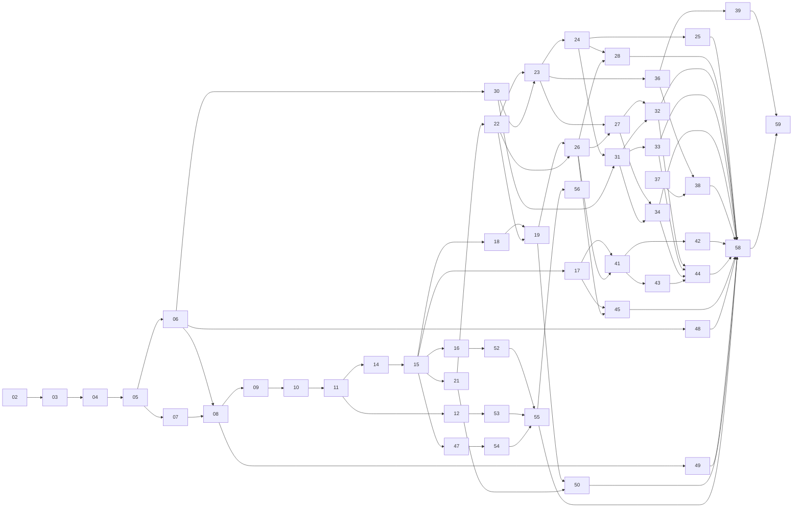

# Build the first working Foundry software factory

Type: request
Status: open
**Planning model:** pi-claude-subscription/claude-opus-5-5

Foundry does not exist yet as code. This request builds P0: one operator, on one machine, runs a factory of Pi agents. The agents take tickets from specification through implementation, review and verification, and Foundry merges the approved work. Everything goes through a command-line tool, and nothing is lost when a worker or the daemon crashes. When P0 is done, the operator can run a factory end to end without a dashboard, and the design is proven on macOS and Linux.

**In scope**

- Everything marked P0 in `prd.md` version 0.2: the daemon, Worker Host, persistence, YAML configuration, rooms, persistent and pooled stations, slots, channel, priming, repository context, the eight agent tools, durable messaging, requests, delegations, tickets, production lines, approvals, limits, the factory clone, worktrees, two hooks, integration, sync, reconciliation and recovery, operator holds, the CLI and management API, events and logs.
- The two v1 seams: worker hosting (§3.2) and memory (§5.4.3).
- The launch gates of §17.2 on macOS and Linux, the launcher decision (RPC or SDK) they settle, and the three checks of §17.3.
- The five-part P0 bar of §18.1, proven on one factory.

**Out of scope**

- Memory beyond the §5.4.3 seam, and the memory layer investigation: P1, Phase 4.
- Dashboard, TCP API with authentication, MCP, GitHub integration, initiatives and work packages: P1.
- The two-factory demonstration and isolation testing: the V1 bar (§18.2). Multiple factories are modelled in P0 and only one is tested.
- `herdr-core`, Hermes, sandboxing, verification improvements: P2.
- Phase 6 hardening, a service manager, publication, provider or network unavailability policy (still open in §19, not required by the P0 bar).

**Estimate:** 520 h (human, without AI), excluding ticket 56. If RPC fails a gate and the SDK fallback (56) runs, add 60 h.

## Tickets

Epics group the work. Each epic's sub-tickets are vertical slices: every one adds a behaviour that can be observed through the CLI, the API or a real worker, and is proved at the cheapest test tier. Epics are not runnable; submit their sub-tickets.

| # | Ticket | Type | Tier | Depends on |
|---|---|---|---|---|
| 01 | [Walking skeleton: a primed worker visible through the CLI](../.scratch/foundry-p0-build/issues/01-epic-walking-skeleton.md) | epic | | |
| 02 | [Scaffold the TypeScript workspace and test harness](../.scratch/foundry-p0-build/issues/02-scaffold-workspace-and-test-harness.md) | task | mid | None |
| 03 | [Validate factory YAML structure with `foundry validate`](../.scratch/foundry-p0-build/issues/03-validate-factory-yaml-structure.md) | task | mid | 02 |
| 04 | [Resolve effective station settings and print each Tool Set](../.scratch/foundry-p0-build/issues/04-resolve-station-settings-and-tool-sets.md) | task | mid | 03 |
| 05 | [Start the daemon with a state root, lock and database](../.scratch/foundry-p0-build/issues/05-daemon-state-root-lock-and-database.md) | task | mid | 04 |
| 06 | [Serve the management API with status, factory list and shutdown](../.scratch/foundry-p0-build/issues/06-management-api-status-and-shutdown.md) | task | mid | 05 |
| 07 | [Run a detached Worker Host that owns launches](../.scratch/foundry-p0-build/issues/07-worker-host-process.md) | task | mid | 05 |
| 08 | [Launch a Pi worker into every slot and show slots](../.scratch/foundry-p0-build/issues/08-launch-workers-into-slots.md) | task | mid | 06, 07 |
| 09 | [Connect workers over the channel with host-confirmed identity](../.scratch/foundry-p0-build/issues/09-channel-handshake.md) | task | large | 08 |
| 10 | [Send the fresh prime and record its acknowledgement](../.scratch/foundry-p0-build/issues/10-fresh-prime-and-acknowledgement.md) | task | mid | 09 |
| 11 | [Freeze slots under an operator hold and unfreeze them](../.scratch/foundry-p0-build/issues/11-operator-holds-and-frozen-slots.md) | task | mid | 10 |
| 12 | [Check the Tool Set at every hello and freeze on a mismatch](../.scratch/foundry-p0-build/issues/12-tool-set-check-at-hello.md) | task | mid | 11 |
| 13 | [Durable messaging between agents](../.scratch/foundry-p0-build/issues/13-epic-durable-messaging.md) | epic | | |
| 14 | [Make agent tool calls exactly-once; ship discover and status](../.scratch/foundry-p0-build/issues/14-agent-tool-calls-discover-and-status.md) | task | mid | 11 |
| 15 | [Accept, route and deliver `agent_message` with receipts](../.scratch/foundry-p0-build/issues/15-agent-message-delivery.md) | task | mid | 14 |
| 16 | [Let the operator send messages with `foundry message send`](../.scratch/foundry-p0-build/issues/16-operator-message-send.md) | task | small | 15 |
| 17 | [Reconcile unacknowledged messages on reconnect](../.scratch/foundry-p0-build/issues/17-reconcile-unacknowledged-messages.md) | task | mid | 15 |
| 18 | [Ship asynchronous requests and replies with deadlines](../.scratch/foundry-p0-build/issues/18-requests-and-replies.md) | task | mid | 15 |
| 19 | [Ship tracked delegations within a ticket](../.scratch/foundry-p0-build/issues/19-delegations.md) | task | mid | 18, 22 |
| 20 | [Tickets through a production line](../.scratch/foundry-p0-build/issues/20-epic-tickets-through-a-production-line.md) | epic | | |
| 21 | [Submit tickets and assign them at the first stage](../.scratch/foundry-p0-build/issues/21-submit-and-assign-tickets.md) | task | mid | 15 |
| 22 | [Move tickets on reported outcomes](../.scratch/foundry-p0-build/issues/22-outcomes-and-transitions.md) | task | mid | 21 |
| 23 | [Create ticket worktrees and guard non-writing stages](../.scratch/foundry-p0-build/issues/23-ticket-worktrees-and-writing-guard.md) | task | mid | 22, 30 |
| 24 | [Gate stages on operator approval and void stale approvals](../.scratch/foundry-p0-build/issues/24-approval-gates-and-voiding.md) | task | mid | 23 |
| 25 | [Ship `human_request` and `foundry approval answer`](../.scratch/foundry-p0-build/issues/25-human-request.md) | task | small | 24 |
| 26 | [Pause, resume, retry and cancel tickets](../.scratch/foundry-p0-build/issues/26-operator-ticket-actions.md) | task | mid | 19, 22 |
| 27 | [Run `after_create` and raise hook-failure holds](../.scratch/foundry-p0-build/issues/27-after-create-hook.md) | task | mid | 23, 26 |
| 28 | [Enforce the rejection limit, message budget and delegation depth](../.scratch/foundry-p0-build/issues/28-limits.md) | task | mid | 24, 26 |
| 29 | [Git integration](../.scratch/foundry-p0-build/issues/29-epic-git-integration.md) | epic | | |
| 30 | [Create the factory clone on first start](../.scratch/foundry-p0-build/issues/30-factory-clone.md) | task | small | 06 |
| 31 | [Integrate the approved commit and clean up](../.scratch/foundry-p0-build/issues/31-integrate-approved-commit.md) | task | mid | 24, 30 |
| 32 | [Verify integration when the default branch has moved](../.scratch/foundry-p0-build/issues/32-integrate-moved-default-branch.md) | task | mid | 27, 31 |
| 33 | [Sync the factory clone from its source](../.scratch/foundry-p0-build/issues/33-factory-sync.md) | task | mid | 31 |
| 34 | [List and clean worktrees with `before_remove`](../.scratch/foundry-p0-build/issues/34-worktree-clean.md) | task | mid | 27, 31 |
| 35 | [Repository context and compaction](../.scratch/foundry-p0-build/issues/35-epic-repository-context-and-compaction.md) | epic | | |
| 36 | [Send repository context with each assignment](../.scratch/foundry-p0-build/issues/36-repository-context.md) | task | mid | 23 |
| 37 | [Investigate whether Pi reports automatic and mid-run compaction](../.scratch/foundry-p0-build/issues/37-investigate-compaction-event.md) | investigation | mid | None |
| 38 | [Re-prime in place after compaction](../.scratch/foundry-p0-build/issues/38-compaction-prime.md) | task | mid | 36, 37 |
| 39 | [Check repository context with a real model](../.scratch/foundry-p0-build/issues/39-real-model-repository-context-check.md) | investigation | mid | 36 |
| 40 | [Recovery after crashes and restarts](../.scratch/foundry-p0-build/issues/40-epic-recovery.md) | epic | | |
| 41 | [Relaunch a dead worker with a recovery prime and resume notice](../.scratch/foundry-p0-build/issues/41-relaunch-dead-worker.md) | task | mid | 17, 26 |
| 42 | [Park slots at the recovery limit and reset them](../.scratch/foundry-p0-build/issues/42-recovery-limit-park-and-reset.md) | task | mid | 41 |
| 43 | [Reconcile in a fixed order after a daemon restart](../.scratch/foundry-p0-build/issues/43-daemon-restart-reconciliation.md) | task | mid | 41 |
| 44 | [Reconcile interrupted operations](../.scratch/foundry-p0-build/issues/44-interrupted-operations.md) | task | mid | 32, 33, 34, 43 |
| 45 | [Raise stuck-worker holds; interrupt and restart slots](../.scratch/foundry-p0-build/issues/45-stuck-worker-interrupt-restart.md) | task | mid | 17, 26 |
| 46 | [Operating the instance](../.scratch/foundry-p0-build/issues/46-epic-operating-the-instance.md) | epic | | |
| 47 | [Stop a factory and shut down the instance](../.scratch/foundry-p0-build/issues/47-factory-stop-and-shutdown.md) | task | mid | 15 |
| 48 | [Stream events with `foundry events`](../.scratch/foundry-p0-build/issues/48-event-stream.md) | task | mid | 06 |
| 49 | [Write logs and read them with `foundry logs`](../.scratch/foundry-p0-build/issues/49-logs.md) | task | mid | 08 |
| 50 | [Refuse a factory whose open records name removed config](../.scratch/foundry-p0-build/issues/50-factory-start-refusal.md) | task | small | 19, 21 |
| 51 | [Launcher decision: launch gates on macOS and Linux](../.scratch/foundry-p0-build/issues/51-epic-launcher-decision.md) | epic | | |
| 52 | [Launch gate 1: survival and reconnect](../.scratch/foundry-p0-build/issues/52-gate-survival-and-reconnect.md) | investigation | mid | 16 |
| 53 | [Launch gate 2: resource isolation and the Tool Set](../.scratch/foundry-p0-build/issues/53-gate-resource-isolation.md) | investigation | mid | 12 |
| 54 | [Launch gate 3: explicit stop](../.scratch/foundry-p0-build/issues/54-gate-explicit-stop.md) | investigation | mid | 47 |
| 55 | [Record the launcher decision](../.scratch/foundry-p0-build/issues/55-record-launcher-decision.md) | task | small | 52, 53, 54 |
| 56 | [Validate an SDK-based worker (only if RPC fails a gate)](../.scratch/foundry-p0-build/issues/56-sdk-worker-fallback.md) | task, conditional | large | 55 |
| 57 | [P0 acceptance](../.scratch/foundry-p0-build/issues/57-epic-p0-acceptance.md) | epic | | |
| 58 | [Prove the P0 bar with faux-provider workers](../.scratch/foundry-p0-build/issues/58-p0-bar-journey.md) | task | mid | 25, 28, 32, 33, 34, 38, 42, 44, 45, 48, 49, 50, 55 |
| 59 | [Run one real ticket end to end with a real model](../.scratch/foundry-p0-build/issues/59-real-model-ticket.md) | investigation | mid | 39, 58 |

## Dependency graph

An arrow points from a prerequisite to the ticket it unblocks. Only hard dependencies are drawn: a ticket needs code, data or a decision its prerequisite produces. Editing the same files is not a dependency. Transitive edges are left out, so a ticket's `Depends on` line names only its direct prerequisites.

**Critical path:** 02 → 03 → 04 → 05 → 06 → 08 → 09 → 10 → 11 → 14 → 15 → 21 → 22 → 19 → 26 → 41 → 43 → 44 → 58.

**Runnable at once:** 02 and 37. Ticket 37 tests bare Pi 1.6.0 and needs no Foundry code.

**Wide points:** after 15, the messaging (16, 17, 18), ticket (21) and shutdown (47) work fan out. After 23 and 26, Git integration (27, 31 to 34), repository context (36, 38) and recovery (41 to 45) run in parallel.

**Real model:** 39 and 59 use the operator's Claude Code login through the `pi-claude-subscription` provider extension, configured on the station; no API key is needed. **Needs the operator:** the gates 52 to 54 need a macOS run and a Linux run. 56 runs only if 55 records that RPC failed a gate.

Decisions and assumptions

### Decisions

- **Location and tracker (operator).** Tickets live in `.scratch/foundry-p0-build/issues/`, which git ignores; this file (`docs/p0-build-plan.md`) is the Request Ticket, and `issues/NN-<slug>.md` holds epics and sub-tickets in one flat numbered sequence. Each ticket carries `Status:` and `Blocked by:` lines for the local tracker convention, and a `**Depends on:**` line with the same numbers for Factory. A sub-ticket names its epic with `**Part of:**`.
- **Workflow (operator).** A Factory batch, later. Tickets carry `**Model tier:**` and `**Planning model:**` only, with no exact Pi model selector. Nothing is submitted. Factory needs a remote before it can run them; the operator has deferred that.
- **Epics of vertical slices (operator).** Sub-tickets are grouped into epics. Each sub-ticket adds behaviour that can be checked through the CLI, the API or a real worker, not a layer that only becomes checkable later. The walking skeleton (01) comes first.
- **Gate the real host (operator).** The launch gates run against the real Worker Host and Foundry extension, not throwaway spike code. Only P0 acceptance (58) waits on the launcher decision; the rest of the build goes ahead on RPC, the PRD's first choice.
- **Investigation then proof for the launcher.** The three gates (52 to 54) are investigations with three allowed outcomes. The proof ticket (55) has a positive acceptance criterion and is the hard dependency for acceptance. The SDK fallback (56) is conditional on 55 recording a failed gate.
- **Real model through the Claude subscription (operator).** The real-model checks (39, 59) use the `pi-claude-subscription` provider extension (`~/.pi/agent/extensions/pi-claude-subscription/index.ts`). It runs the `claude` CLI for each request, using the operator's Claude Code login, so no API key is needed. Workers do not inherit global Pi extensions (ticket 08), so the factory YAML lists the provider as a hooks-only configured extension, and the station model is `pi-claude-subscription/<model>`. The worker's unfiltered environment lets the `claude` CLI find the login.
- **Invalid factory YAML refuses the whole daemon (05c).** Every factory file named on `foundry daemon` is validated before the state root is claimed; any invalid one stops start with one line on stderr and exit 1, and nothing is written to the state root or the daemon log. This is distinct from 50a to 50c, where a valid factory whose open records name removed configuration is refused alone (`factory.start_refused`) and the others start.

### Assumptions and defaults

- **Test runner: Vitest.** It is not pinned by any decision and is a local, reversible choice. Two suites: `npm test` (unit and integration, every commit) and `npm run test:e2e` (real `pi` 1.6.0 processes with the faux provider, merge-request and nightly tier). End-to-end tests prove wiring only.
- **Faux provider.** The scripted faux model from the coding-agent spike (its source is reproduced in ticket 02; the spike branch was removed) is ported into the test kit. It turns `@@ <tool> <json>` lines in the latest user message into tool calls. Faux workers run with `PI_CODING_AGENT_DIR` pointed at a temporary directory.
- **Pi pinned at 1.6.0.** The coding agent and `@earendil-works/pi-ai` are pinned exactly. The host resolves the pinned `pi` binary, overridable by `FOUNDRY_PI_BIN` for tests.
- **Evidence files.** Investigation and gate evidence goes in `docs/evidence/<name>.md` on the main line, unlike the planning-phase research, which was not kept, because the launcher decision rests on it.
- **Resume notice lands with operator actions (26).** Resume is the first command that sends one; worker relaunch (41) and daemon restart (43) reuse the same composer.
- **Holds land early (11).** The first operator hold kind, frozen slot, brings the hold record type and `foundry hold list | show`; every later hold kind adds to it.
- **Freeze before messaging.** Agent tool calls from a frozen worker must be refused, so 14 waits on 11.
- **host.log: no rotation in P0.** The detached host's stderr is an fd its starter opens, so the host cannot reopen it; growth is bounded by launch count (49a).

### Investigations

- **Launcher (52 to 56).** Whether RPC passes the three §17.2 gates on macOS and Linux. Evidence: one `docs/evidence/launch-gate-<n>.md` per gate with platform, Pi and Node versions, exact launcher argv, effective fixture resources and observations. Blocks 55, and through it 58. If a gate fails, 56 validates an SDK worker to the same evidence; if both fail, headless launch stays blocked and no gate is weakened.
- **Compaction event (37).** Whether `session_compact` fires for automatic and mid-run compaction in Pi 1.6.0. Blocks 38.
- **Real model (39).** Whether a real model, launched neutrally, acts on injected repository context and reads an indexed skill on demand. Needs an operator key. Blocks 59.
- **`--tools` on Linux with a model call (§17.3).** Folded into gate 2 (53): a faux model calls a named extension tool on both platforms.

Implementation plan

### Approach

Build a walking skeleton first: a daemon in the foreground, a detached Worker Host, one Pi worker per slot connected over the channel and primed, all visible through the CLI. Then grow it in vertical slices that follow the PRD's dependency order: messaging, then tickets and production lines, then Git integration, then repository context, then recovery. Each slice is checkable against a named PRD section or decision and proved at the cheapest tier. The launch gates run once the real host can stop and isolate workers. The final acceptance journey proves the five-part P0 bar.

### Changes

- **Workspace (02).** npm workspaces under `packages/`: `protocol` (channel frames in `Schema`, used by both ends), `daemon` and `cli` (Effect 4 programs on exactly pinned `effect`, `@effect/platform-node` and `@effect/sql-sqlite-node` at 4.1.5), `host` (the Worker Host), `extension` (the Foundry Pi extension, plain TypeScript with promises and no Effect runtime) and `testkit`.
- **Effect boundary.** Each unstable Effect module (SQL with the SQLite driver and migrator, HTTP server, Unix socket server, `effect/cli`) is imported by exactly one Foundry module behind a Foundry-owned interface. YAML is parsed with the `yaml` package. No Effect YAML, process, workflow or cluster.
- **Persistence.** One SQLite database (WAL) per state root, opened only by the daemon. Current-state tables with an append-only history beside them, written in the same transaction (ADR 0001). The history row's per-instance sequence number is the event ID. Only absolute times are stored.
- **Order of build:** configuration (03, 04) → daemon and API (05, 06) → host and launch (07, 08) → channel (09) → prime (10) → holds and freezing (11, 12) → messaging (14 to 19) → tickets and lines (21 to 28) → Git (30 to 34) → repository context (36, 38) → recovery (41 to 45) → operating (47 to 50) → gates (52 to 55) → acceptance (58, 59).

### Verification

- Unit: pure functions such as configuration resolution, the transition table, routing choice, prime composition and the recovery classification rules.
- Integration: one per boundary. A real SQLite file, a real Unix socket, real Git in a temporary directory, and the Worker Host with a stub command in place of `pi`.
- End-to-end: real `pi` 1.6.0 workers with the faux provider, only for wiring journeys. Each ticket names the journey it adds.
- Gates: manual runs on macOS and Linux, recorded as evidence files.

### Deploy

Nothing to deploy. P0 runs from the repository on the operator's machine: `npm install`, then `foundry daemon <factory.yaml>` in the foreground. No service manager, no published package.

### Tasks

The table at the top lists every ticket, with its tier and dependencies. Implementation models come from Factory's configured tier mapping. Planning provenance for every ticket is `pi-claude-subscription/claude-opus-5-5`.

## Handoff

Filed locally under `.scratch/foundry-p0-build/issues/`: nine epics (01, 13, 20, 29, 35, 40, 46, 51, 57) and 50 runnable sub-tickets. Nothing is submitted. To run them as a Factory batch, the repository first needs a remote and the tickets need to be filed in its tracker. Then the operator submits the runnable sub-ticket IDs, not the epics. Filing does not check runtime admission.
