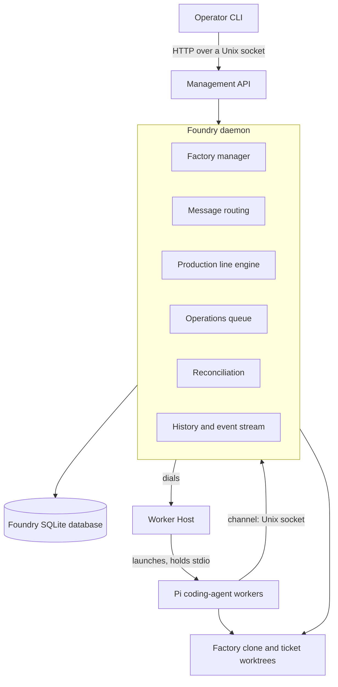
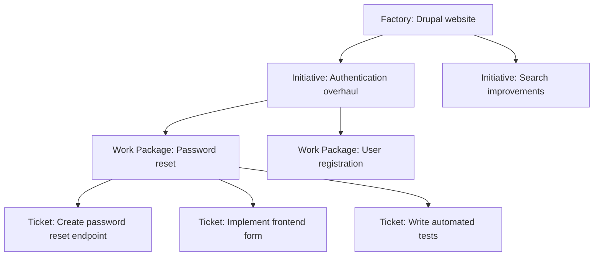
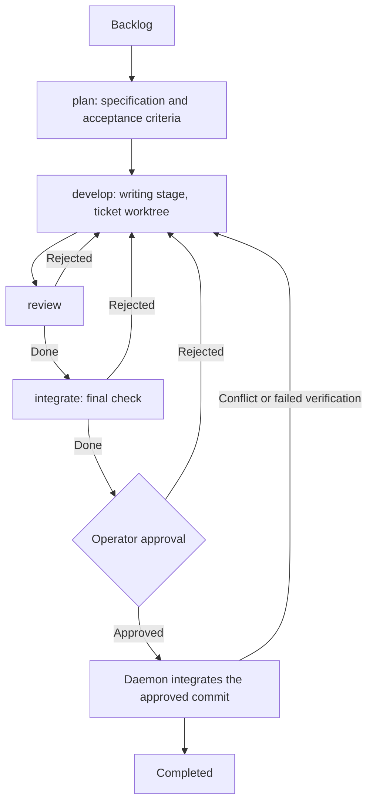

# Foundry: Product Requirements Document

**Version:** 0.2  
**Status:** Revised against the P0 decisions, 2026-11-24  
**Architecture:** Pi-native, durable, single-host agent orchestration  
**Product philosophy:** Build a software factory, not another general-purpose agent harness.

Foundry is a lightweight orchestration platform for persistent teams of Pi agents that collaboratively plan, implement, review, test and integrate software. Inspired by OpenRig's declarative team structures, Foundry differentiates itself through native structured agent messaging, durable orchestration state, deterministic production lines and an intentionally focused technology stack.

The primary objective is to let a developer operate multiple autonomous software factories while retaining visibility, control and human oversight.

This document states what was decided, in planning sessions held before any code was written; §19 lists each decision and its outcome. Vocabulary is defined in [`GLOSSARY.md`](GLOSSARY.md). Each section marks what ships in P0 and what waits; §19 lists what is still open.

## 1. Product objectives

- Support persistent, independently operating agent teams.
- Run each worker as an independent Pi coding-agent process behind a thin runtime adapter.
- Provide reliable, structured, durable inter-agent messaging, with Foundry as the authoritative inbox.
- Define team structures and production lines through declarative configuration.
- Support concurrent tickets within a factory.
- Enforce deterministic production lines.
- Give the operator visibility into tickets, slots and factory activity.
- Recover from crashes, interruptions and restarts by reconciling records against what actually exists.
- Allow external agents, such as Hermes, to manage factories (P2).

### Worker hosting at launch: headless only

Foundry v1 shall run Pi workers headless, as independent processes owned by a Worker Host that is itself independent of the daemon. Pi remains the agent runtime, and inter-agent communication uses the worker channel and registered agent tools.

### Deferred: `herdr-core` backend

Support for `herdr-core` as an optional backend hosting interactive terminal sessions with Pi workers is deferred to P2. V1 shall preserve the worker hosting seam described in §3.2 so that this backend can be added as another worker host without changing messaging, production lines, persistence or recovery.

### Non-goals for v1

Multiple agent harnesses; `herdr-core` or any other interactive terminal session backend; distributed execution across machines; replacing Pi; building a terminal multiplexer or requiring one for core operation; simulated keyboard input; a plugin marketplace; hosted SaaS; replacing GitHub Projects or other issue trackers; sandboxing workers (§14); Hermes inter-operation (§13.4).

## 2. Product terminology

| Component | Definition |
|---|---|
| Factory | An independently managed development organization. |
| Room | A logical grouping of stations sharing responsibilities, policies or knowledge. |
| Station | A persistent, named agent role within a factory. |
| Worker | A running agent instance occupying a station. |
| Initiative | A larger development objective, potentially with its own integration branch. |
| Work Package | An independently implementable and verifiable deliverable. |
| Ticket | An individual unit of work. |
| Production Line | A configurable workflow through which work progresses. |
| Backlog | Pending work awaiting processing. |
| Evidence | Artifacts demonstrating that requirements have been satisfied. |

A factory may contain multiple rooms, each containing multiple stations. A station has one or more slots, each occupied by one worker at a time. Stations and slots are durable; workers are their executing runtime instances.

The decisions added terms this document relies on: instance, state root, slot, worker host, host reference, launch, conversation, channel, priming, situation, repository context, tool set, knowledge root, stage, assignment, outcome, transition, delegation, acknowledgement, approval, writing stage, integration, ticket directory, reconciliation, indeterminate, frozen, parked, resume notice, operator hold, factory clone and operation. [`GLOSSARY.md`](GLOSSARY.md) defines each.

## 3. System architecture



**Instance and state root.** One instance is a daemon, a Worker Host and the factories they serve. It has one state root: `~/.foundry` by default, overridden by `FOUNDRY_HOME` or `--home`. The state root holds the database, the management and channel sockets, the Worker Host's socket and registry, the factory clones, the ticket directories, the per-slot launch folders and the logs. A lock file stops a second daemon starting on the same root.

The dashboard and MCP reach the daemon through the same management API in P1 (§12, §13). Hermes follows in P2 (§13.4).

### 3.1 Technology stack

| Component | Technology |
|---|---|
| Language | TypeScript |
| Daemon and CLI | Effect 4 programs on `effect`, `@effect/platform-node` and `@effect/sql-sqlite-node`, pinned to exact versions (4.1.5 today) |
| Worker-side code | Plain TypeScript with promises; no Effect runtime |
| Worker runtime | Pi coding agent, one process per worker, behind Foundry's runtime adapter |
| Protocol | A shared package defining every channel frame once in `Schema`, used by both ends |
| Persistence | One SQLite database per instance (`node:sqlite`, WAL), opened only by the daemon |
| Configuration | YAML, parsed with the `yaml` npm package and validated with `Schema` |
| Agent instructions | Markdown |
| Management API | HTTP/JSON over a Unix-domain socket |
| Live events | Server-Sent Events |
| Worker channel | Newline-delimited JSON over a Unix-domain socket |
| Worker launching | `node:child_process`, detached, inside the Worker Host |
| Development isolation | Git worktrees |
| External agent integration | MCP (P1) |
| Dashboard | Lightweight locally served web application (P1) |
| Process supervision of the daemon | None in P0; the daemon runs in the foreground (§11.6) |

The daemon operates independently of individual workers. No worker is responsible for keeping the factory alive.

**Effect.** Only the core and `Schema` are stable in Effect 4. Each unstable module adopted (SQL with the SQLite driver and its migrator, the HTTP server, the Unix-domain socket server, `effect/cli`) sits behind a Foundry-owned interface, so only one module of Foundry imports it. Minor upgrades are deliberate, one at a time, gated by the test suite. Foundry does not use Effect's YAML parser, `effect/process`, workflow or cluster: tickets, transitions, assignments, approvals and messages are Foundry's own tables, driven by ordinary Effect code in transactions. Request timeouts and retry backoff are also Foundry's.

**Database.** Only the daemon process opens the database. The CLI goes through the management API. The Worker Host never touches the database or the management API and keeps its own small registry of launches.

**Platforms.** macOS for development, Linux for deployment.

### 3.2 Worker hosting seam

V1 ships one worker host, headless. The following keep a later interactive backend such as `herdr-core` an additive change.

**Workers dial the daemon.** A Foundry Pi extension loaded in each worker registers the agent tools and opens the channel.

- One Unix-domain socket per instance, with one long-lived bidirectional stream per worker. Frames are newline-delimited JSON, each validated by the shared protocol package.
- The same stream carries messages, receipts, state, control requests and agent tool calls, correlated by ID.
- The first frame carries a protocol version; a mismatch is rejected, not negotiated.
- Filesystem permissions on the socket are the only access control in P0. There is no TCP listener.
- Worker stdin and stdout carry no Foundry traffic, because an interactive backend needs the terminal for the worker's own interface.

**Launch identity.** The Worker Host issues a factory ID, slot ID and launch ID to each launch through its environment. The extension presents all three in its opening `hello`, with an opaque conversation reference, whether the conversation has recoverable history, an informational `mode`, and the worker's tool names and their sources. The daemon accepts the connection only after the host confirms that launch is the current one for that slot. There is no per-launch secret in P0. A PID, a socket connection or a Pi session ID never serves as identity.

- One accepted connection per slot. A newer `hello` from the same launch replaces the older connection; frames from a superseded connection are dropped.
- A launch the host does not confirm is refused with a terminal reason: the extension stops reconnecting and its agent tools fail from then on.
- If the host is unreachable or ownership is unknown, the daemon refuses with a retryable reason and the slot is frozen.
- An unchanged conversation reference is an ordinary reconnect. A changed one (`/new`, `/resume`, fork, clone) freezes the slot. P0 has no way to adopt a changed conversation.

**One Worker Host per instance.** The host runs detached from the daemon and serves its own Unix socket in the state root, because it must outlive the daemon. The daemon dials it. `foundry daemon` starts the host if none answers and adopts it otherwise; only `foundry shutdown` stops it.

- The host launches and supervises workers. For RPC launches it holds each worker's stdin open and continuously drains stdout and stderr, without unbounded buffering.
- It serializes starts by factory and slot and can report the current launch for a slot even if the daemon died before saving the start reply.
- It distinguishes live, known gone and unknown ownership. Only a host-confirmed vacant slot is eligible for a new launch.
- It records a boot identifier with each launch (§10.2).
- Losing the daemon connection neither stops workers nor makes their slots vacant.
- Launch exits and other reports travel back on the daemon's connection, and the daemon asks for anything it missed when it reconnects.

**Host references are opaque.** A host reference identifies one launch, not a slot, PID or Pi session. The daemon stores it and only the worker host interprets it.

**The runtime adapter is thin.** The daemon sees Foundry's worker protocol and opaque references. The adapter translates delivery intent, lifecycle and priming into Pi behaviour; Pi's queues, session file and IDs, extension callbacks and compaction mechanics do not leak into orchestration. No second runtime is implemented or checked in P0.

**Launcher.** RPC mode is the first choice, conditional on the launch gates in §17.2. If RPC cannot pass a gate on either platform, an SDK-based coding-agent worker is validated instead, to the same evidence. If neither passes, headless launch stays blocked; no gate is weakened. This choice is still open (§19).

**How a worker is launched.**

- In a neutral per-slot folder under the state root, never in a worktree or the factory clone, because a slot outlives any one ticket and Pi fixes a conversation's working folder for life.
- With `--no-context-files` and `--no-approve`, and one plain `--tools` list.
- With the Worker Host's full environment, unfiltered, plus a slot marker (for example `FOUNDRY_SLOT`). An environment allowlist is P1.
- With the effective model and the configured skills and extensions, without substituting defaults or inheriting the operator's own Pi resources.

**Tool Set.** Every worker has twelve fixed tools: Pi's `read`, `bash`, `edit` and `write`, and the eight agent tools (§6.1). A station adds only the tools named on its configured extensions (§4). MCP, codemode and tool search are off. The daemon compares the tools reported in every `hello`, including after `/reload`, with the station's Tool Set, and refuses with a terminal reason, tool set mismatch, when a named tool is missing, an extra one is present, a built-in does not come from Pi, or an agent tool does not come from the Foundry extension. The slot is frozen and the host stops the launch (§5.3). The check runs at `hello` only; a later change within the same connection is not detected.

**Daemon-initiated control.** Besides messages and primes, exactly two requests:

- `drain`: the extension stops injecting held messages and reports when Pi settles. A graceful stop uses it before the host terminates the process.
- `interrupt`: the extension aborts the current run, for an operator pause, retry or cancel of a ticket and for a stuck worker. It is not `urgent` delivery, and agents cannot send it.

Process termination stays with the Worker Host and never travels on the channel.

**Timing constants.** Heartbeat every 5 s, channel considered lost after 15 s, reconnect backoff capped at 5 s, agent tool calls wait 30 s for the channel. These are starting values fixed as constants, not factory configuration.

**Interactive host.** The only concession in the protocol is the `mode` field. Operator-typed input, session commands from a person and how an interactive host confirms launches are not designed.

## 4. Factory configuration

A factory is defined in strict, versioned YAML. This is the P0 contract.

```yaml
version: 1
name: example-factory
repository:
  source: ../example-project
  default_branch: main
default_production_line: feature
worktrees:
  root: ~/worktrees
  branch_pattern: 'ticket/{ticket-id}-{slug}'
  after_create: [./scripts/setup-worktree]
  before_remove: [./scripts/cleanup-worktree]
knowledge:
  root: knowledge
message_budget: 100
delegation_depth_limit: 2
recovery_limit: 3
defaults:
  instructions: factory.md
  model: ${DEFAULT_MODEL}
  skills: [skills/project/SKILL.md]
  extensions:
    - extensions/audit.ts            # hooks only
    - path: extensions/project.ts
      tools: [web_fetch, jira_get]
rooms:
  planning:
    stations:
      planner:
        instructions: roles/planner.md
  engineering:
    instructions: rooms/engineering.md
    stations:
      developer:
        instructions: roles/developer.md
        instances: 3
        isolation: worktree
      reviewer:
        model: ${REVIEW_MODEL}
        extensions: []               # clears the extensions and their tools
        isolation: worktree
      integrator:
        isolation: worktree
production_lines:
  feature:
    rejection_limit: 3
    verify: [npm, test]
    stages:
      - id: plan
        station: planning.planner
      - id: develop
        station: engineering.developer
        writing: true
      - id: review
        station: engineering.reviewer
        on_rejection: develop
      - id: integrate
        station: engineering.integrator
        approval: true
        on_rejection: develop
```

**Shape and defaults.**

- Required: `version`, `name`, `repository.source`, `repository.default_branch`, `default_production_line`, `rooms` and `production_lines`.
- A room contains `stations` and optional shared `instructions`. Stations are addressed as `room.station`, even in a one-room factory.
- `instances` defaults to 1; a larger positive integer defines a fixed pool of slots.
- `isolation` defaults to `none`; `worktree` selects the ticket worktree and is not a security boundary.
- `worktrees` is optional. The root defaults to `~/worktrees`, with a directory per factory beneath it, and the branch pattern defaults to the one shown.
- `knowledge.root` is optional and defaults to `knowledge/` beside the YAML (§5.4.3).
- Hooks and `verify` are argument lists, run with no implicit shell from the relevant worktree.
- Default limits: 100 accepted messages per ticket, delegation depth 2, 3 failed recoveries, and per line 3 rejections per ticket. `recovery_limit` is a factory setting and is rejected on a line.
- `when_idle` and `after_turn` are per-message policies, not YAML settings.

**Names.** Room and station names are lowercase letters, digits and hyphens, starting with a letter. A station name is unique across the whole factory, and rooms and stations share one namespace. `packs`, `lore` and `factory` are reserved.

**Inheritance.**

- Instructions: each value is a path to one file. The supplied files are composed in factory → room → station order.
- Model: a station overrides `defaults.model`. Every station must end up with an explicit `provider/model` selector.
- Skills and extensions: explicit local paths set as factory defaults. Omission inherits, a station list replaces, and `[]` clears. The Foundry extension is always loaded.
- Rooms have no model, skill, extension or tool overrides.

**Extension tools.** An `extensions` entry is a path string or an object with `path` and `tools`. A tool registered by a configured extension reaches the worker only when the YAML names it; an entry with no names contributes hooks only. The names travel with their extension through inherit, replace and clear. Names are exact: no patterns, no name listed twice in a station's effective set, and no reserved name (every Pi built-in, the eight agent tools, `codemode`, `tool_search`, anything starting `mcp__`). There is no separate tool field and no per-station variation of the fixed tools.

**Placeholders and paths.** A whole-field `${NAME}` in a model field resolves after YAML parsing from the invoking process environment; an unset or empty variable is an error. Foundry expands placeholders nowhere else and evaluates no shell expressions. Relative filesystem paths resolve from the YAML's directory. Command arguments are not resolved as paths.

**Production lines.**

- Stage IDs are unique within a line and independent of the stations serving them.
- `writing` and `approval` default to false. A writing stage must use a worktree station.
- `on_rejection` names an earlier stage by ID. A reported rejection with no configured route pauses the ticket with a blocked approval (§8.2).
- The final stage must be non-writing, use the ticket worktree, require approval, and name an earlier writing stage as its rejection target. That route also handles merge conflicts and failed verification.

**Validation.** `foundry validate` and daemon start share the same offline, read-only checks.

- Rejected: malformed YAML, duplicate keys, unsupported versions, unknown keys (including known P1 settings such as `on_demand`, capacity and communication permissions), wrong types, invalid limits, missing or unreadable configured files, invalid path or branch settings, empty command arrays, unresolved models, missing line or station references, duplicate stage IDs, invalid rejection routes or final-stage contracts, and the name and tool-name rules above.
- A local repository source is checked as a path; a URL is checked for form without contacting it.
- A line with no `verify` command is a warning, not an error.
- YAML locations are reported where available.
- Validation never clones, probes remotes or providers, executes commands, launches workers or creates the knowledge root. It does not prove that workers load their resources; that is launch evidence (§17.2).
- It prints each station's effective Tool Set, with the extension each named tool comes from, stating that registration by the extension is not checked.

**Loading.** Configuration is read only at daemon start; P0 has no live reload. The daemon stores the validated configuration and its hash for each load. Start is refused for a factory if any open record names a stage, station or slot that no longer exists: a ticket not yet completed or cancelled, an unacknowledged message, or an open delegation. A refused factory does not stop the others, and the CLI shows the records that block it.

## 5. Rooms and stations

### 5.1 Rooms

**P0.** A room is a grouping with optional shared instructions. It gives its stations their `room.station` address and has a reserved directory under the knowledge root. Room membership does not create a shared conversation; each worker keeps its own. Rooms are not security sandboxes.

**P1.** Room-level policies, knowledge resources, default models, communication permissions, and resource and concurrency limits.

### 5.2 Stations

A station is a durable role with a stable identifier. Its configuration is instructions, model, skills, extensions with named tools, pool size and isolation.

| Type | Behavior | Ships |
|---|---|---|
| Persistent | One slot with long-running conversational continuity. | P0 |
| Pooled | A fixed number of interchangeable slots (`instances: N`). | P0 |
| On-demand | Starts when work becomes available. | P1 |
| Temporary | Created for a specific authorized responsibility. | P1 |

A slot is its station name plus an ordinal, written `station/ordinal`. A slot's conversation outlives any launch and ends only when the operator resets the slot.

### 5.3 Worker lifecycle

**States.** The extension reports only what it can observe: `working`, `idle` (from Pi's settled signal, not the end of a run) and a compaction event. The daemon derives starting, recovering, draining and stopped from host and assignment facts. None of these is stored; they are rebuilt when workers reconnect.

**Heartbeats.** The extension heartbeats on a fixed interval. A missed heartbeat means only that the channel is lost. Whether the worker is alive is the Worker Host's call.

**Slot conditions.** A slot is normal, frozen or parked.

- **Frozen**: the daemon sends it nothing and launches nothing into it until the operator resolves it. The causes are host lost, unknown ownership, changed conversation reference, an acknowledged prime with no recoverable history, an instruction file missing at priming time, and tool set mismatch. Its ticket stays assigned with its status unchanged, its unacknowledged messages stay bound and are not re-routed, request deadlines keep running, and agent tool calls from a still-connected frozen worker are refused. Other slots, the integration queue and new assignments elsewhere carry on.
- **Parked**: taken out of use after its recovery limit was reached, whether or not it held an assignment. A parked-slot hold is raised with it (§10.2).

**Resolving a slot.** Three strengths of intervention on a running worker, and two resolutions of a frozen or parked slot:

- Interrupt: aborts the run. The conversation and launch are kept.
- Restart: the host terminates the launch and starts a new one in the same conversation.
- Unfreeze: the operator asserts the cause is fixed. The daemon re-runs the same checks and freezes again if they still fail. After a tool set mismatch it starts a new launch in the same conversation and rechecks; a corrected YAML needs a daemon restart first, and the slot stays frozen across it.
- Reset: the operator confirms the old launch is gone or has the host kill it. The daemon discards the conversation, starts a new launch with a `fresh` prime, and re-offers the slot's unacknowledged messages. Reset is the only way to unpark a slot. It clears the slot's own recovery counter, the one used while it is unassigned, and never counts against an assignment's. Resetting a parked slot resolves its hold but leaves its ticket paused. It refuses when the host cannot confirm the old process group is gone, unless forced.

**Recovery limit.** The counter is per assignment and counts every unexpected end of a launch while the slot holds that assignment, including a death before the first turn. It does not count daemon restarts, operator stops, operator restarts of a stuck worker, a launch stopped for a tool set mismatch, or channel loss with the launch still alive. Operator actions, including reset, never change it.

- The limit is the factory's `recovery_limit`, for assigned and unassigned slots alike.
- An assignment carries a recovery ceiling beside its counter, starting at `recovery_limit`. Reaching it is one transaction: the ticket is paused, the assignment suspended, the slot parked, and one parked-slot hold raised on the slot with the paused ticket in its evidence. No approval is raised.
- `ticket resume` raises the ceiling by `recovery_limit` when the counter has reached it. The counter is never reset while the assignment lives. `ticket retry` creates a new assignment, at zero with a fresh ceiling.
- A slot with no assignment that keeps dying is parked at the same limit, with the same hold and no ticket.

**Stuck worker.** A stuck worker still heartbeats. When an injected message has stayed unacknowledged for 15 minutes on such a worker, the daemon raises an operator hold and does nothing else. The clock excludes `when_idle` messages held while the worker is working, and the prime. The hold clears itself if the message is acknowledged.

A worker failure does not terminate its factory or other workers. `agent_spawn` and `agent_retire` are P1, so P0 workers are neither spawned nor retired by agents.

### 5.4 Memory and continuity

**Priority: P1, delivered in Phase 4, directly after the P0 software factory.** Foundry shall reach capability parity with OpenRig's memory model. Memory is not required for the first working factory, but P0 preserves the seam in §5.4.3 so that it is an additive change.

**Provisional until the memory layer investigation.** Before Phase 4 is committed, investigate alternative memory layers. Cognee and Beads are candidates, and others are welcome. The investigation decides whether parity with OpenRig stands, changes or is replaced, and whether the §5.4.3 seam is still sufficient for what it selects. Until then §5.4.1 and §5.4.2 describe the standing direction, not a commitment.

Memory belongs to a station, room or factory, not to a worker. A station's knowledge survives every worker that occupies it, so pooled, on-demand and recovered workers do not start cold.

#### 5.4.1 Memory model

Memory is authored Markdown at fixed, addressable paths under a per-factory knowledge root. The path is the identity. OpenRig's seat, pod, rig, mission and slice map to Foundry's station, room, factory, initiative and work package or ticket.

| File | Scope | Content | Writer |
|---|---|---|---|
| `LEARNED.md` | Factory, room, station | What this station, room or factory has learned: its job, standing duties, practices with their reasons, authorities, relationships, trigger pointers and dated lessons. | Its owner only |
| `RECAP.md` | Station | The current handover recap. Superseded recaps are retained unchanged. | The station |
| `lore/<slug>.md` | Station | One situation or fact per file, with a stable address and frontmatter for stage, method, date and owner. | The owning station |
| `CULTURE.md`, `SOP.md` | Factory, inherited downward | Slow-changing values and procedure. | Their owners |
| `NOTES.md` | Initiative, work package, ticket | Lived notes on the work, beside its specification and evidence. | Whoever is doing the work |
| Context packs | Factory | A manifest plus files, composed into profiles for a situation. | Authored |

#### 5.4.2 Required behavior

- **Situation-based priming.** The daemon composes a worker's starting context for one of the three situations of §5.5: fresh start, recovery and compaction. Handing a station over to a new worker is a recovery, with the recap supplying what the previous worker knew.
- **Fixed recovery order.** A recovering station is primed with its current recap, then its `LEARNED.md`, then the latest runtime restore state, then superseded recaps as optional reading. A missing file is reported as a named gap, never silently skipped.
- **Composed, never generated.** Priming assembles authored files and sections by address, each carrying its source path and content hash. Foundry shall not generate summaries at priming time.
- **Pushed to the worker.** The daemon delivers composed context over the channel; a fresh worker is not expected to discover it. This replaces OpenRig's paced terminal delivery.
- **Volatile facts as commands.** Facts that change faster than the file are stored as the command that derives them. A primed worker re-derives them and records a dated delta, which a second reader checks.
- **Proactive memory capture.** Workers should use their judgment to save or update useful knowledge as they encounter it, without waiting for a prompt or seeking approval. Existing write ownership rules still apply.
- **Ticket-end memory reporting.** At the end of a ticket, report any knowledge added or updated during that ticket that will persist beyond it. Summarize what changed and identify its scope and file path so the operator can spot and correct inaccurate memories. Reporting is for visibility, not sign-off; it does not gate saving the knowledge or closing the ticket.
- **Distillation.** Lessons are folded into practices at handover and at initiative boundaries; the remainder is archived, not accumulated.
- **Read grants.** One station reads another's memory only by explicit grant, and composed content stays attributed to its owner. Lore does not leave the factory.
- **Maturity stages.** Lore and pack items carry a stage from `wip`, `provisional`, `established`, `canonical`, `superseded`, `retired`.

Parity excludes what OpenRig also deliberately omits: automatic transcript mining, embeddings or semantic search, a curator role, and sharing between factories. It also excludes OpenRig's per-harness compaction and restore machinery for Claude and Codex, which Foundry delegates to Pi.

If the investigation keeps parity with OpenRig, then before Phase 4 starts audit OpenRig's handover service, compaction skills and workspace primitive against this list. This section was written from OpenRig's reference documentation and may be incomplete.

#### 5.4.3 Seam preserved in P0

- **Stable addresses.** Factory, room and station identifiers are stable, independent of any worker, and safe to use as path segments (§4 naming rules).
- **Reserved knowledge root.** `knowledge.root` names a per-factory directory. The layout is flat: the root itself for the factory, `<root>/<room>/` for a room and `<root>/<station>/` for a station. There is no factory prefix and no directory per slot or worker. The daemon creates the directories at startup and leaves them empty in P0. Workers do not write to the knowledge root in P0; this is a convention stated in the prime, not enforced.
- **One priming step.** Every prime passes through the single daemon-side step of §5.5, which takes the situation as an input. In P0 it supplies configured instructions only.
- **Work artifacts are addressable files.** Each ticket's specification and evidence live in its ticket directory (§8.3), so `NOTES.md` can sit beside them later.

### 5.5 Priming and repository context

**Priority: P0.**

**Prime.** A prime is a short daemon-written header stating the worker's `room.station` address, slot and situation, followed by the configured instruction files composed factory → room → station. The header also states two conventions: an `isolation: none` station writes only in the ticket directory, and workers do not write to the knowledge root. Nothing else is included: no ticket context, no backlog summary, nothing generated.

- It travels only as the `prime` frame and is injected into the conversation as a message. The adapter sets no Foundry system prompt, so there is one priming path.
- It is acknowledged by the same receipt rule as a message (§6.3).
- Each composed part carries its source path, relative to the YAML's directory, and a content hash. The daemon records the situation and the path-and-hash list of every prime it sends.
- The daemon reads and hashes the files at each priming, so an edit takes effect at the worker's next prime. Running workers are not re-primed when a file changes. A file missing at priming time fails the prime and freezes the slot.

**Situation.** The daemon decides it from its own records, never from Pi, and only after reconciliation:

- `fresh`: no prime has been acknowledged for the slot's current conversation.
- `recovery`: a prime has been acknowledged and the launch is new.
- `compaction`: the extension reported a compaction.
- No prime: a reconnect from the same launch.

Every situation carries the same full body and differs only in the header's situation line.

**Ordering.** The prime is sent after reconciliation and before any message on that connection. Messages follow straight after it without waiting for its receipt. The prime never starts a turn on its own. Because Pi writes no session file until its first assistant message, an idle fresh worker holds an unacknowledged prime indefinitely, so the prime is exempt from stuck-worker detection.

**Compaction.** When the extension reports a compaction, the daemon sends one `compaction` prime on the same connection, injected at the next tool-round boundary and ahead of any held messages. The worker is not restarted. If the channel is down when Pi compacts, the extension keeps the event and reports it after reconnecting.

**Repository Context.** Because workers launch outside the repository, Foundry reproduces as text what Pi would have discovered inside it:

- The context files at the worktree root (`AGENTS.override.md`, `AGENTS.md` or `CLAUDE.md`), following Pi's override rule.
- `.pi/APPEND_SYSTEM.md`.
- An index of the repository's skills from `.pi/skills` and `.agents/skills` (name, description, path), whose bodies the worker reads on demand.

Not reproduced: repository extensions, MCP servers, project settings and packages, prompt templates and `.pi/SYSTEM.md`. Discovery stops at the worktree root. The operator's global instructions and skills stay out; `defaults.instructions` is the place for anything factory-wide.

- It is an ordinary daemon-written message sent alongside the assignment, not a prime.
- Its source is the ticket's worktree at each assignment, so a later stage sees the branch's version. An `isolation: none` station gets it from the default branch in the factory clone.
- The daemon records its paths and content hashes.
- It is not sent when the hashes match what that conversation last received.
- After a compaction prime it is re-sent in full while the slot holds an assignment.

## 6. Native agent messaging

**Priority: P0, foundational.** Foundry shall not use simulated keyboard input, terminal injection or terminal scraping for inter-agent communication. Communication occurs through the channel and registered agent tools.

### 6.1 Agent tools

| Tool | Responsibility | Ships |
|---|---|---|
| `agent_discover` | Discover the factory's stations and slots. | P0 |
| `agent_status` | Inspect station or slot availability. | P0 |
| `agent_message` | Send a durable message. | P0 |
| `agent_request` | Send a request requiring a reply before a deadline. | P0 |
| `agent_reply` | Reply to a request, or resolve a delegation. | P0 |
| `agent_delegate` | Create a tracked delegation to another station within the current ticket. | P0 |
| `task_transition` | Report an outcome (done, rejected or blocked) for the worker's own assignment. | P0 |
| `human_request` | Ask the operator for a decision; recorded as an approval. | P0 |
| `agent_spawn` | Request an authorized worker instance. | P1 |
| `agent_retire` | Retire an authorized worker. | P1 |

**Tool calls.** Each call is one request frame and one result frame, keyed by a submission key the extension derives from the launch ID and Pi's tool call ID. The tool returns only after the daemon's result, which follows the commit. The daemon stores one submission record per call with the result it returned; a retry returns the stored result and changes nothing. Two separate calls with the same body stay distinct. While disconnected, a call waits a bounded time for the channel and then returns an explicit "not accepted" error; it never reports success before the daemon commits.

### 6.2 Message structure

An illustrative message record. The field names are not a wire or storage contract.

```json
{
  "id": "msg_01",
  "factory": "example-factory",
  "sequence": 412,
  "kind": "request_notice",
  "sender": "planner/1",
  "recipient": "engineering.developer",
  "slot": "developer/2",
  "ticket": 142,
  "request_id": "req_01",
  "delivery": "after_turn",
  "status": "sent",
  "body": "Assess the proposed implementation."
}
```

- **Sender.** The daemon takes the sender from the accepted connection's slot, never from the frame.
- **Kind.** Ordinary, request notice, delegation notice, reply or resume notice.
- **Order.** A per-factory acceptance sequence number.
- **Status.** Unbound, bound, sent, acknowledged, indeterminate, dropped or expired. Each delivery attempt is kept as an append-only row.
- **Ticket.** Decided by the daemon: a reply inherits the ticket of its request or delegation; any other send takes the ticket of the sender slot's active assignment; with neither, the message has no ticket.
- **Body.** Stored in the database.
- `priority` and threading are P1.

### 6.3 Messaging requirements

**Accepted.** A message is accepted when Foundry has committed it to its database, before returning success or attempting delivery. Foundry is the authoritative inbox. Accepted messages survive worker termination, daemon crashes and shutdown.

**Routing.** A message addressed to a station is routed to one slot, never broadcast. Messages are considered in acceptance order. The daemon chooses an eligible slot deterministically, preferring the ticket's assigned slot when it belongs to the recipient station. A message stays unbound while no slot is eligible, and the binding is committed before any send. Retries stay with that slot, including across a replacement launch. Routing does not change a ticket's assignment.

**Delivery.** The daemon sends each bound message once per connection, in acceptance order, without waiting for the worker to report idle. The extension applies the policy.

| Policy | Behavior | Ships |
|---|---|---|
| `after_turn` | Inject at once. Pi starts a turn if idle, or takes the message after the current tool round if working. | P0 |
| `when_idle` | Hold in memory until Pi settles, then inject and start a turn. | P0 |
| `steer` | Not a separate policy: both runtimes deliver it as `after_turn`. | Dropped |
| `urgent` | Request interruption, subject to permissions and safety. | P1 |

Order is first in, first out within a policy; an `after_turn` message may overtake an earlier `when_idle` one. Queued messages wait indefinitely; only requests expire.

**Acknowledgement.** A message is unacknowledged until Foundry records the extension's receipt, which is sent only once the message ID is in the worker's recoverable conversation history. Receipt at the socket, an in-memory enqueue, an injection and the start of a turn are not acknowledgements. An acknowledgement stops delivery retries and says nothing about whether the worker answered or did the work.

**Reconcile before retry.** A lost receipt does not justify reinjection. After every reconnect the daemon lists the unacknowledged messages it previously sent to that slot, and the extension answers each as in history, still pending or absent.

- In history: acknowledged without reinjection.
- Pending: left alone.
- Absent: sent again only when the original copy can no longer be consumed. That is established in exactly two cases: a new launch, where the host confirms the old launch is gone and the ID is absent from the restored history; or the same launch, where the extension reports it absent and Pi has settled idle.
- A same-launch worker that reports absent while still working is re-checked when it settles.
- Otherwise the message is indeterminate and waits for the operator (§10.2).

This is not exactly-once execution, and never permission to replay an interrupted tool call.

**Shipping in P0:** persist before delivery, acknowledgements, duplicate detection, request-reply correlation, delivery retries and request timeouts. **P1:** threading, configurable expiration and priority.

### 6.4 Communication boundaries

- **P0.** Any station may message any other station in its factory, directly and without a relay. Messages are routed within one factory.
- **Message budget.** Every agent-sent message with a ticket spends one unit at acceptance. Daemon-written messages (ticket context, repository context, resume notices, operator messages and answers) spend none. The message that reaches the limit is accepted, and the ticket is paused with a limit-reached approval in the same transaction.
- **Delegation depth limit.** A delegation beyond the limit is refused.
- **Request timeouts.** §6.5.
- **P1.** Configurable communication permissions between stations and rooms, and rate limits.

Messaging and delegation stay distinct: an ordinary message never creates a work obligation.

### 6.5 Requests and delegations

**Requests are asynchronous.** `agent_request` returns a request ID and deadline after acceptance and does not hold the worker's turn. `agent_reply` correlates by request ID, may come only from the selected recipient slot, and is routed to the requesting slot, including across a replacement launch. The first valid reply committed before the deadline completes the request. Late replies are recorded without reopening it. An expired request is not sent if delivery was never attempted, and a copy already sent is not retracted. Deadlines are wall-clock and do not pause while the daemon is down.

**A delegation is a tracked obligation within a ticket.** `agent_delegate` commits the obligation and its notice together, recording the root assignment, any parent delegation, the delegating slot, the recipient station and the depth. No new ticket is created. Only the selected recipient slot can resolve it, with `agent_reply` keyed by delegation ID carrying an explicit outcome and evidence; the result returns to the delegating slot. An acknowledgement is not completion.

- `task_transition` with a done outcome is refused while the assignment has open delegations.
- A pause preserves them.
- Ending an assignment as abandoned or cancelled closes its whole delegation tree in the same transaction.

## 7. Work management



P0 runs standalone tickets. Initiatives and work packages are P1.

### 7.1 Initiatives

**P1.** An initiative groups related development work and may define an integration branch, target milestone, dependencies and completion criteria. Multiple initiatives must operate concurrently inside the same factory.

### 7.2 Work packages

**P1.** A work package is an independently verifiable deliverable containing one or more tickets. It supports a specification, dependencies, acceptance criteria, evidence requirements and integration target. Initiatives and work packages are optional.

### 7.3 Tickets

Tickets are the primary units of execution. In P0 a ticket record holds:

- A per-factory sequential number, a title and a slug.
- Its production line, named at submission or taken from the factory default.
- Its ticket directory path.
- Its current stage and status.
- Two counters, rejections and messages spent, each with a ceiling beside it.
- The worktree path, branch name and starting commit, stored when the worktree is created, so a later change to the root or branch pattern never moves a ticket in flight.

Its history is its transitions (§8.2). Its specification and evidence stay as files; the database holds paths only. Ticket dependencies and external issue identifiers from GitHub are P1.

## 8. Production lines

**Priority: P0.** Production lines define deterministic workflows. A worker reports an outcome; the daemon decides and records the transition.

### 8.1 Example production line



### 8.2 State model

**States.** A ticket is in the backlog, at a stage, completed or cancelled. At a stage it has a status: queued, assigned, awaiting approval or paused. A stage is served by one station; an assignment binds a ticket at a stage to one slot of that station.

**Line entry.** The backlog is the queue in front of the first stage. The daemon moves a ticket into the first stage as soon as its station has capacity, oldest first. A ticket queues at any stage until a slot is free.

**Outcomes.** With `task_transition` a worker reports done, rejected or blocked for its own assignment, with a reason and evidence references. The daemon looks up the next stage from the line's configuration. A worker never names a destination, so it cannot skip a stage.

- A done outcome with no commit is refused for stages that work on code.
- A done outcome is refused while the assignment has open delegations.
- An outcome from a non-writing stage is refused if the branch head moved or tracked files have uncommitted changes (§9.2).
- Blocked: the ticket keeps its stage, its status becomes paused with the worker's reason, an approval is recorded, and the slot is freed.
- Rejected at a stage with no `on_rejection` route: the same as blocked, with a blocked approval. The transition records the outcome as rejected, and it does not count toward the rejection limit.

**Approvals.** An approval is an operator decision the factory is waiting on. Its kinds are stage gate, worker request, blocked and limit reached.

- A stage marked `approval: true` becomes awaiting approval when its worker reports done. Only an operator API call resolves it, so no message can bypass a gate.
- `human_request` creates a worker-request approval. It does not gate a transition; the operator's answer returns as a message.
- Blocked and limit-reached approvals are resolved by acting on the ticket: resume, retry or cancel resolves the approval in the same transaction.

**Transitions.** Every change to a ticket's stage or status writes exactly one transition, including those the daemon causes. It records actor, time, from and to, outcome, reason, the Git commit evaluated, evidence references and the configuration load it ran under. Transitions are never updated or deleted.

**Voiding.** A review, QA or operator approval is bound to the commit it evaluated. If the ticket's branch head later differs, that approval is void: one daemon transition names the transitions it voids and returns the ticket to the earliest voided stage. Whether a stage's done still holds is answered by comparing its transition's commit with the branch head.

**Assignments.** An assignment is active, suspended or ended. At most one is not ended per ticket, and at most one is active per slot.

- A pause suspends it: it holds no slot capacity but keeps its delegations, requests, recovery counter and recovery ceiling (§5.3).
- Resume reactivates the same assignment if the ticket returns to the same slot. If another slot takes it, the old assignment ends as abandoned and a new one is created.
- Rejection, a voided approval and retry always create a new assignment.

**Returning tickets.** A ticket returning to a stage it has been through goes back to the slot that last held it there, and queues for that slot if it is busy. If that slot is gone or parked, any free slot of the station takes it, and the ticket stays queued at the stage when there is none.

**Worker death.** The ticket stays assigned to the same slot while the worker is recovered (§10.2). At the recovery limit the ticket is paused and its slot parked (§5.3).

**Limits.** A line sets a rejection limit per ticket; the factory sets the message budget. Reaching either pauses the ticket with a limit-reached approval. Resolving it by resume or retry grants one more full allowance: the ticket's ceiling rises by the configured amount and the transition records it. The counter is never reset. Cancel is the way to refuse.

**Operator actions.** Each is a transition with the operator as actor.

- Pause: the daemon interrupts the worker and suspends the assignment, freeing the slot.
- Resume: reactivates the same assignment. Open delegations, requests and the recovery counter are kept, and the worker gets a resume notice plus an optional message. An assignment at its recovery ceiling gets one more full allowance. Resume is accepted while the ticket's slot is parked; another slot then takes the ticket, which ends the old assignment as abandoned. On a ticket paused by a failed `after_create` before its first assignment, resume reruns the hook and then queues the ticket.
- Retry: ends the assignment as abandoned and creates a new one for the slot that last held the ticket. Open delegations and requests are closed as abandoned and the other slots told, the recovery counter starts at zero, and the worker gets the full ticket context again. Allowed on a paused or assigned ticket; on an assigned one the daemon interrupts the worker first.
- Cancel: the worktree is kept until the operator cleans it up.

Neither resume nor retry touches the worktree, branch or ticket directory.

**Scheduling.** Assignment is deterministic and separate from outcomes: a step reads committed state and assigns queued tickets. A crash between an outcome and the next assignment leaves a queued ticket, which the step picks up at restart.

**P1.** Ticket dependencies, parallel stages, conditional transitions, return to backlog, and moving a ticket to a named stage.

### 8.3 Specifications and evidence

Each ticket has a ticket directory at a predictable path under the state root, for example `<state root>/tickets/<ticket-id>/` with `spec.md` and `evidence/`. It exists from submission, every stage's worker can read and write it, and it never touches the branch. `foundry ticket submit` copies the submitted file into it.

A planning station should produce structured specifications:

```markdown
# Specification
## Objective
## Requirements
## In Scope
## Out of Scope
## Dependencies
## Acceptance Criteria
## Verification Plan
## Required Evidence
```

Evidence may include automated test results, screenshots, build logs, review findings, performance measurements and Git commits. Evidence is tied to the commit evaluated.

**P2: verification improvements.** Formal verification, stronger validation, and richer evidence. No design exists; in P0 verification is each line's `verify` command, the review stages and the operator's approval.

## 9. Git integration and development isolation

**Priority: P0.** The daemon integrates; no worker ever writes to the default branch. P0 has no initiative branches.

### 9.1 Factory clone

A factory works in a dedicated clone that only Foundry uses. `repository.source` names a local path or URL; Foundry creates the clone under the state root on first start and marks it as Foundry-owned.

- The daemon never contacts the source on its own. `foundry factory sync` fetches the source's default branch and merges it into the clone's, fast-forward when possible.
- On a conflict the daemon aborts the merge, restores the recorded head and marks the sync failed. The queue stays open, and a sync-conflict hold is raised (§10.2). The operator pulls the clone's default branch into their own repository, resolves the conflict there, pushes to the source and runs the sync again. Nothing but Foundry works in the clone.
- Tickets in flight are unaffected by a sync until they integrate.
- P0 never pushes. The clone is an ordinary Git remote for the operator's working repository: the operator pulls the default branch from it and pushes to the real remote themselves. `foundry factory path` prints the clone's path.

### 9.2 Worktrees and branches

- One worktree and one branch per ticket for its whole life, handed from stage to stage. This is safe because P0 stages are sequential.
- Worktrees default to `~/worktrees/<factory>/<ticket-id>-<slug>` and branches to `ticket/<ticket-id>-<slug>`.
- Both are created when the ticket is first assigned at a stage whose station has `isolation: worktree`, from the default branch head at that moment.
- Only a writing stage may change the branch. When any other stage's worker reports an outcome, the daemon refuses it if the branch head moved or tracked files have uncommitted changes, and tells the worker to revert. A reviewer who wants a change rejects instead.

### 9.3 Integration

The final stage is a non-writing check: its worker trial-merges the default branch in a scratch area, checks the evidence is complete, and writes an integration summary for the operator. Its done outcome opens the operator's approval.

On approval the daemon merges the exact approved commit: a merge commit, or a fast-forward when possible, whose second parent is the approved commit. The ticket branch is never rewritten, so approvals stay valid.

- If the default branch has moved since the ticket branched, the daemon builds the merge result in a temporary worktree, runs `after_create` and then the line's `verify` command there, and moves the default branch only if it passes.
- A line with no `verify` command merges unchecked when the default branch has moved.
- A failing `verify` is a rejection back to the writing stage.
- A conflict aborts the merge, leaves the default branch untouched and records a rejection with the conflicting files as the reason. The developer merges the default branch into the ticket branch and resolves it; the new head voids approvals, so later stages run again. It counts toward the rejection limit.
- A failing `after_create` in the temporary worktree is an environment problem, not a rejection: the ticket pauses with the hook log, approvals stay valid, and a hook-failure hold is raised (§10.2). The operator runs `foundry integration retry` or cancels the ticket.

### 9.4 Operations

An operation is a repository action the daemon performs itself: integration, source sync, worktree creation, each hook run and cleanup. One record type covers them, with a status of queued, running, interrupted, complete, failed or indeterminate.

- The integration and sync queue is the queued operations, so an approved integration or a requested sync survives a restart. At most one integration or sync runs per factory at a time.
- Intent first, result after: the operation commits as running, with its intent, before any Git or hook action starts. Its result commits afterwards together with everything it causes.
- A factory's queue can be closed, with a recorded cause, while an integration is indeterminate (§10.2). A hook failure or a sync conflict does not close it, because the default branch is untouched.

### 9.5 Lifecycle hooks

```yaml
worktrees:
  after_create: [./scripts/setup-worktree]
  before_remove: [./scripts/cleanup-worktree]
```

- `after_create` runs once after a worktree is created. A failure pauses the ticket before any worker is assigned. `foundry ticket resume` reruns the hook in the same worktree and then queues the ticket; `ticket cancel` gives up.
- `before_remove` runs before a worktree is removed. A failure blocks automatic removal; the ticket stays completed. `foundry worktree clean` reruns the hook and removes, and `--force` skips the hook.
- A failed hook raises a hook-failure hold on the ticket (§10.2). A second failure raises a fresh one.
- Each runs in the worktree, with its exit status and log kept.
- Hooks must tolerate running twice, because recovery reruns them (§10.2). `foundry validate` documents this and cannot check it.

This supports Drupal and WordPress projects that need a separate DDEV environment per worktree.

### 9.6 Cleanup

After a successful integration the daemon removes the worktree and deletes the branch. A cancelled ticket's worktree is kept until the operator runs `foundry worktree clean`. Cleanup refuses when there are uncommitted or untracked changes, when the branch has commits not in the default branch, or when a `before_remove` hook failed, unless the operator forces it.

**P1.** `before_integrate` and `after_integrate` hooks, per-stage worktrees, any push to a remote, automatic sync, and initiative integration branches.

## 10. Durability and recovery

**Priority: P0.** Durability is foundational.

### 10.1 Persistent state

**Two stores, two owners.** Foundry's database holds orchestration state and every accepted message, and is authoritative for both. Pi saves and restores a worker's conversation, not its execution: a restored conversation does not mean the interrupted work resumed, and an interrupted tool call is not safe to replay because the session reopened.

**Current state is authoritative** ([ADR 0001](docs/adr/0001-current-state-is-authoritative.md)). The database holds current-state records with an append-only history beside them. Every change writes its history row in the same transaction, and nothing is rebuilt by replay. History is kept forever in P0. Every row carries a factory ID.

Durable records:

- **Run**: one per daemon start, with the start time, version and configuration loads.
- **Configuration load**: the validated configuration and its hash.
- **Ticket, transition and assignment** (§7.3, §8.2).
- **Slot**: its condition with cause, the recovery counter for when it is unassigned, its current launch and its current conversation.
- **Conversation**: one per slot at a time, with the opaque reference and a status of current or discarded.
- **Launch history**: the daemon's copy of what the Worker Host reports, with launch ID, slot, boot identifier, start, end and exit reason. Where the two disagree, the host wins on liveness and the database on everything else.
- **Message, delivery attempt, request and delegation** (§6).
- **Prime and repository context records**: situation, path-and-hash list and acknowledgement, per slot and conversation.
- **Submission record**: one per agent tool call (§6.1).
- **Approval** (§8.2) and **operator hold** (§10.2), as separate record types.
- **Operation** (§9.4).

**What commits together.**

- An agent tool call: the submission record, every effect of the call and the stored result.
- An outcome report: the transition, the ticket's new stage and status, the ended assignment, and any approval or queued integration it causes.
- A new assignment: the assignment, the ticket's status, its transition, and the daemon-written message carrying the ticket context.
- A receipt: the acknowledgement, the attempt row, and the clearing of any stuck-worker hold for that message.
- A reply: the reply message and the completion of its request or delegation.
- Resolving an approval or a hold, with its consequence.

**Timers.** None are persisted. Only absolute wall-clock times are stored. Request expiry, stuck-worker detection and retry backoff are recomputed from those at start and by a periodic sweep. Connections, heartbeats and working or idle state are not stored.

**Operator calls** carry no submission key in P0. They are guarded by state checks, so repeating a resolved action is refused, not deduplicated.

**Not in P0.** A backup command (the operator copies the file while the daemon is stopped), history pruning, and live configuration reload. The daemon refuses to start against a schema newer than it knows.

### 10.2 Recovery

**Reconciliation order after a daemon restart.** Fixed, with each step gating only what depends on it:

1. Open the database and mark every operation recorded as running as interrupted.
2. Ask the Worker Host which launch holds each slot: adopt, vacant or freeze.
3. Reconcile interrupted operations per factory. That factory's integration and sync queue stays closed until this finishes; its workers keep running.
4. Accept channels. Per connection, reconcile messages and the prime, then send.
5. Only then make new assignments and stage moves.

A stuck integration never stalls workers, and one frozen slot never stalls a factory.

| Failure | Behavior |
|---|---|
| A launch ends unexpectedly | A new launch in the same slot and conversation, a `recovery` prime, and a resume notice if the slot holds an assignment. Counts against the recovery limit. |
| Daemon crashes | Workers keep running and reconnect. Reconciliation runs in the order above. |
| Machine restarts | A Worker Host started after a reboot is positive proof that every earlier launch is gone. Those slots are vacant and get ordinary recovery launches, counted against the recovery limit. The operator starts the daemon again. |
| Worker Host lost while the machine stays up | Its slots are frozen. P0 does not rebuild a lost registry or adopt orphan processes. |
| Recipient offline | The message stays with Foundry, unbound or bound, until an eligible slot can take it. |
| Ticket interrupted | It stays assigned to its slot, with its worktree intact. |
| Context exhausted | Pi compacts; the daemon re-primes in place (§5.5). |
| Provider or network unavailable | No Foundry policy in P0 (§19). The daemon itself makes no network calls except an operator-requested sync. |

**Resume notice.** A prime never starts a turn, so the daemon restarts interrupted work with a resume notice: a daemon-written message sent whenever a slot holding an assignment is idle after reconciliation, following a new launch or a daemon restart. It states the ticket and stage; that the worker was interrupted or the daemon was unavailable; that the last tool call may or may not have completed, so the worktree and ticket directory must be inspected before continuing; and the assignment's reported outcome, open requests and open delegations by ID.

- Resumption is automatic, with no operator gate and no replay of any tool call.
- It is an ordinary `after_turn` message, exempt from the message budget.
- At most one is outstanding per assignment; a second interruption replaces its content.
- An agent tool call committed before the crash stands, and the notice shows what was accepted. A `task_transition` committed before the worker died is honoured, and no notice is sent for that assignment.

**Interrupted operations.**

- **Integration.** The recorded intent is the ticket, the approved commit and the default branch head at that moment. If the default branch head is the approved commit, or a merge of the recorded head and the approved commit, it is complete. If it is still the recorded head, nothing landed: the temporary worktree is discarded and the integration reruns from the start, so hooks and verification may run twice. Anything else is indeterminate.
- **Source sync.** Never rerun automatically. If the fetched commit is already an ancestor of the default branch, it is complete. Otherwise the daemon aborts any half-finished merge, restores the recorded head, marks the sync interrupted and reopens the queue.
- **Worktree creation.** If the worktree and branch both exist and the branch has no commits beyond its starting point, both are removed and created again. If the branch has commits, it counts as created.
- **`after_create`.** Rerun from the start in the same worktree.
- **Cleanup and `before_remove`.** Rerun. An already-removed worktree or already-deleted branch counts as done.

**Operator holds.** A hold is something waiting on the operator that concerns the system's state, not a decision about work. Holds are listed beside approvals as a separate record type, with at most one open per kind and subject.

| Kind | Evidence shown | Resolution |
|---|---|---|
| Frozen slot | Cause, launch ID, the host's last report, conversation reference, held ticket; for a tool set mismatch, the missing, extra or replaced tools with their sources | Unfreeze or reset |
| Parked slot | Launch history with exit reasons, and the paused ticket if the slot held an assignment | Reset. The ticket stays paused until `ticket resume`, `retry` or `cancel` |
| Hook failure | Hook name, operation ID, exit status, log path | `ticket resume` or `cancel` for a first `after_create`; `integration retry` or `ticket cancel` for the integration's; `worktree clean` for `before_remove` |
| Indeterminate message | Message ID, slot, delivery attempts, the extension's last reconciliation answer | Resend, accepting a possible duplicate, or drop |
| Indeterminate integration | Recorded intent, current default branch head, temporary worktree path | Landed or not landed |
| Interrupted sync | Recorded head, fetched commit | Run the sync again |
| Sync conflict | Recorded head, fetched commit, conflicting files | Resolve in the operator's own repository, push to the source, run the sync again; clears when a sync completes |
| Stuck worker | Message ID and how long it has been unacknowledged | Interrupt or restart; clears itself on acknowledgement |

- **Subjects.** A hook-failure hold concerns a ticket, a sync-conflict hold a factory, and a parked-slot hold a slot. A parked-slot hold stays open until the reset, whatever happens to its ticket, including a cancel. A repeated sync conflict refreshes the hold's evidence.
- **Indeterminate message.** Until it is resolved, later messages bound to that slot wait, so order is preserved. Dropping a request fails it to the requester at once. Dropping a delegation notice closes the delegation as abandoned and tells the delegating slot. The daemon never picks alone.
- **Indeterminate integration.** The ticket is paused, approvals are kept, and the factory's queue stays closed until the operator declares one. Landed: the daemon checks the approved commit is an ancestor of the default branch, records completion and continues to cleanup. Not landed: the daemon records the current head as the new starting point and reruns. The daemon never resets the default branch itself.

**Trust assumption.** Automatic resumption relies on a worker's effects being local and inspectable. What a worker did outside its worktree and ticket directory is not reconciled (§14). Pushes, deployments and other external mutations are outside P0's recovery work, because the daemon never pushes.

### 10.3 Shutdown

```bash
foundry factory stop example-factory [--force]
foundry shutdown [--force]
```

- A named factory stop leaves the other factories and their workers alone. A stopped factory comes back only on the next daemon start.
- A whole-instance shutdown stops every worker and then the Worker Host.
- Both stop assigning new work in scope, send `drain`, allow a bounded grace period, then have the host terminate and, if needed, force-kill the owned worker process groups. `--force` skips the grace period.
- Neither reports success, nor releases a slot for reuse, if an owned process group cannot be confirmed gone. Process groups do not contain descendants that deliberately detach.
- A daemon death is not a stop: workers keep running.
- Recoverable state is preserved, and anything interrupted is left to §10.2.

## 11. Operator command-line interface

**Priority: P0.** The CLI is a thin client of the management API (§13.1): one call per command, except the confirming commands, which read and then act.

### 11.1 Grammar

Noun then verb. Every command takes `--json`, which prints the API response body unchanged. `--factory <name>` is required only when more than one factory is loaded. Tickets are addressed by number, slots as `station/ordinal`, and stations as `room.station`.

```bash
# Instance
foundry daemon <factory.yaml>...          # foreground; loads exactly the files named
foundry shutdown [--force]
foundry validate <factory.yaml>
foundry status
foundry events [--follow] [--since <id>] [--ticket <n>] [--factory <name>]
foundry logs [--host] [--follow] [--ticket <n>] [--slot <station/ordinal>] [--launch <id>]

# Factories
foundry factory list
foundry factory stop <name> [--force]
foundry factory sync <name> [--wait]
foundry factory path <name>

# Tickets
foundry ticket submit <spec.md> [--title] [--line]
foundry ticket list | show <n>
foundry ticket pause | retry | cancel <n>
foundry ticket resume <n> [--message "text"]

# Approvals
foundry approval list | show <id>
foundry approval approve <id>
foundry approval reject <id> --reason "text"
foundry approval answer <id> "text"

# Operator holds and their subjects
foundry hold list | show <id>
foundry slot list | show <station/ordinal>
foundry slot unfreeze | interrupt | restart <station/ordinal>
foundry slot reset <station/ordinal> [--force]
foundry message list | show <id>
foundry message send <room.station> "text"
foundry message resend | drop <id>
foundry integration landed | not-landed | retry <n> [--wait]
foundry worktree list
foundry worktree clean <n> [--force]
```

P0 has no factory registry and no `init`, `up`, `down`, `restart`, `rooms`, `stations`, `workers`, `inbox`, `conversation` or `dashboard` commands.

### 11.2 Observation

- `status`: factories (running, stopped, or refused with the blocking records), slots with their condition and ticket, tickets per stage, pending approvals, open holds, and any closed queue with its cause.
- `ticket show`: transitions, the assignment, the worktree, hook log paths and evidence paths.
- `slot show`: launch history with exit reasons, the Pi session file path and any kept stderr path per launch, prime and repository context records with paths and hashes, and resume notices.
- `approval show` and `hold show` print the exact commands that apply.
- `validate` prints each station's effective Tool Set (§4).

### 11.3 Approvals and holds

- `approve` and `reject` are for stage gates; a reject follows the stage's `on_rejection` route. `answer` is for worker requests. Each is refused on a kind it does not fit.
- Blocked and limit-reached approvals are resolved with `ticket resume`, `retry` or `cancel`.
- `ticket retry` is refused on a ticket paused by a hook failure, since there is no assignment to abandon.
- `ticket resume` and `ticket retry` are accepted while the ticket's slot is parked; `slot reset` does not resume the ticket.
- Holds have no `resolve` verb; commands act on the subject. `message resend` is listed first as the default.

### 11.4 Operator messaging

`foundry message send` creates an ordinary daemon-written message with `when_idle` or `after_turn` delivery, spending no budget. There is no operator inbox: a worker reaches the operator only through `human_request`, which appears as an approval. The operator can list the messages Foundry routed, with their status and delivery attempts. The CLI does not render a worker's Pi transcript.

### 11.5 Confirmation, waiting and exit codes

Six commands ask before acting, each printing exactly what will be lost:

- `ticket resume`, only when another slot will take the ticket: the open delegations and requests that will be abandoned.
- `ticket retry`: the open delegations and requests that will be abandoned. No prompt when there are none.
- `ticket cancel`: the same, plus a note that the worktree is kept.
- `slot reset`: the conversation is discarded.
- `message drop`: the request or delegation that will fail.
- `worktree clean --force`: the uncommitted files and unmerged commits.

`--yes` skips the prompt. Without a terminal and without `--yes`, the command refuses.

An action returns once the daemon has committed it. Queued work returns the operation ID, with `--wait` to block until it finishes.

| Exit code | Meaning |
|---|---|
| 0 | Success |
| 1 | Refused by a state check |
| 2 | Usage error or unconfirmed prompt |
| 3 | Daemon unreachable |
| 4 | Run inside a worker |

**Without a daemon.** `validate`, `daemon` and `logs` need no daemon. Every other command fails fast with exit code 3. Nothing auto-starts the daemon, and nothing reads the database directly.

**Inside a worker.** With the slot marker present the CLI refuses every command except `validate`, before any call, with exit code 4.

### 11.6 Service manager

Not built in P0: no units, no install command, no evidence. Four constraints keep it cheap later:

- `foundry daemon` stays a foreground process that never self-daemonises.
- The daemon adopts a Worker Host it did not start.
- A clean shutdown exits 0, and only instance-level failures (lock held, newer schema, socket in use) exit non-zero.
- A factory whose start is refused never makes the daemon exit.

Workers run headless in v1; attaching an interactive terminal session to a worker waits for the `herdr-core` backend.

## 12. Web dashboard

**Priority: P1.** Provide a locally served dashboard visualizing work, not replicating an IDE. It needs the TCP listener with authentication that P0 does not ship (§13.1).

### Illustrative dashboard (demonstration data)

**Drupal Factory:** 6/8 active workers; 9 open tickets; 1 needs attention.

| Backlog | Planning | Build | Review | QA | Integrate |
|---|---|---|---|---|---|
| #151 Media permissions | #150 Search improvements | #142 Password reset | #138 Cache invalidation | #135 Entity forms | #132 Media upload |
| #152 Content import | | #144 API validation (awaiting input) | | | |
| | | #146 Editor interface | | | |

| Station | Activity |
|---|---|
| Director | Monitoring |
| Planner | Writing specification |
| Developer 1 | Implementing #142 |
| Developer 2 | Awaiting decision |
| Reviewer | Reviewing #138 |
| Integrator | Idle |

The dashboard should support factory selection and ticket details including history, specification, assignment and evidence.

### 12.1 Dashboard requirements

Provide factory health summaries, production line visualization, ticket history, room and station activity, pending approvals and operator holds, routed messages, worktree information and evidence. Support live updates through the event stream. Operators can pause tickets, resolve approvals and holds, inspect errors and message stations. The daemon remains the source of truth; the dashboard must not maintain independent authoritative state.

## 13. External integrations

### 13.1 Management API

**P0.** A versioned JSON API under `/api/v1/`, served as HTTP over a Unix-domain socket in the state root, separate from the worker channel socket. Only the CLI uses it.

- Reads are `GET`; each operator action is its own `POST`. Exact paths are set in the build, one per CLI command.
- An action refused by a state check returns a conflict carrying the current state.
- `GET /api/v1/events` is the Server-Sent Events stream and replays from `Last-Event-ID` (§15).
- File permissions are the only access control. The API is unauthenticated.

**P1.** A TCP listener with authentication, arriving with the dashboard.

### 13.2 MCP integration

**P1.** Expose management capabilities through MCP. A first-party Foundry skill explains terminology, capabilities, operational policies and delegation patterns. No particular external agent is a P1 client; Hermes is P2 (§13.4).

### 13.3 GitHub integration

**P1.** Support importing issues, synchronizing issue status, associating pull requests, updating GitHub Projects fields and publishing verification results. Synchronization is configurable to prevent unintended external edits.

### 13.4 Hermes inter-operation

**P2.** The operator's Hermes agent issues directives and asks questions to Foundry on the operator's behalf: supervising factories, messaging stations, submitting tickets, gathering reports and relaying the operator's approvals. Its actions are attributed to Hermes acting for the operator. Hermes remains outside the factory lifecycle. Whether it uses the MCP surface of §13.2 or something else is not decided. Foundry is fully operable without it.

## 14. Security and resource management

**P0 is not a sandbox.** Workers run as the operator's operating-system user with all of its permissions, because Pi has no sandbox and any worker with `bash` can reach whatever that user can. An operator who needs real containment runs the whole instance (daemon, Worker Host and workers) inside a container, virtual machine or dedicated user. P0 documents that option and does not build or test it.

**What the operator can rely on.**

- The daemon's own checks: an outcome from a non-writing stage is refused when the branch head moved or tracked files have uncommitted changes; approvals are bound to a commit; the daemon integrates only the exact approved commit; the daemon itself never pushes.
- Every worker has the twelve fixed tools plus the tools named on its station's configured extensions, and nothing else, whatever the operator's own Pi settings say. The daemon checks this at every `hello`.
- A worker starts with only the prime, the configured skills and extensions, and the Foundry extension. Nothing ambient loads: not the operator's global instructions or resources, and not the target repository's.
- A ticket branch cannot install code into a worker by committing it. Repository content reaches a worker only as text.
- The `foundry` CLI refuses to act from inside a worker.

These guard against a mistaken or confused worker. None of them stops a hostile one, and a configured extension runs arbitrary code in the worker.

**What remains a trust assumption.**

- A worker writes only in its worktree and ticket directory.
- A worker does not touch the Foundry database, the sockets, the factory clone's Git data, the default branch or other tickets' worktrees.
- A worker does not call the management API directly.
- A worker does not push or otherwise use the operator's Git, SSH or provider credentials beyond its work. "P0 never pushes" is a guarantee about the daemon only.
- A ticket branch does not rewrite repository instructions to mislead a later stage. Such a change is visible in the diff and in the recorded hashes.

**Not built in P0.** No path guard on `edit` or `write`, since `bash` bypasses it and it would give false assurance. No permission gate: a configured extension that asks for confirmation is unsupported, and a worker blocked on one surfaces as a stuck worker. No hardening of the database, sockets or clone beyond file permissions and the CLI's refusal inside a worker.

**Secrets.** Provider keys and Git and SSH credentials pass to workers through the unfiltered environment. Model selectors may reference environment variables. Secrets must not appear in messages or logs.

**Capacity.** P0 capacity is the fixed number of slots per station; a ticket queues until a slot is free.

**P1, in full.** Explicit permissions covering agent communication, worker creation, tool access, filesystem access, Git operations, production line transitions and external API mutations; runtime grants scoped to a ticket, worker, operation or expiration time; approved secret stores; an environment allowlist; maximum concurrent workers, per-room capacity, provider rate limits, execution budgets and automatic backpressure; and binding the management API to localhost with authentication.

**P2: sandboxing.** Run each station's workers inside some form of sandbox that limits their reach, so that confinement stops being a trust assumption. The mechanism is not chosen. Until then the only containment is the operator running the whole instance in a container, virtual machine or dedicated user.

## 15. Observability

### 15.1 Events

Events are the durable history rows, nothing ephemeral. Each row gets a per-instance sequence number, which is the event ID, so the stream is replayable from any known ID. Heartbeats and working or idle state are not events; they appear only in `status` and `slot` snapshots.

Names follow the record that changed. This is the full P0 list; adding a name is a change to this document.

```text
factory.started
factory.stopping
factory.stopped
factory.start_refused
factory.queue_closed
factory.queue_reopened
launch.requested
launch.started
launch.adopted
launch.ended
slot.frozen
slot.unfrozen
slot.parked
slot.reset
prime.sent
prime.acknowledged
message.accepted
message.bound
message.sent
message.acknowledged
message.indeterminate
message.dropped
message.expired
request.opened
request.completed
request.expired
request.failed
delegation.opened
delegation.resolved
delegation.abandoned
ticket.submitted
ticket.transitioned
assignment.created
assignment.suspended
assignment.resumed
assignment.ended
approval.requested
approval.resolved
approval.voided
hold.raised
hold.resolved
hold.cleared
operation.queued
operation.started
operation.interrupted
operation.completed
operation.failed
operation.indeterminate
```

- `ticket.transitioned` is the only event for a change to a ticket's stage or status; from, to, outcome, actor and reason are fields.
- `operation.*` carries the kind as a field: integration, source sync, worktree creation, hook run or cleanup.
- `hold.*` carries the kind as a field: frozen slot, parked slot, hook failure, indeterminate message, indeterminate integration, interrupted sync, sync conflict or stuck worker.
- `message.*` carries the kind as a field, so a resume notice or a repository context message is a `message.*` event of that kind.
- Every event carries its time, the factory ID and the identifiers of the records it concerns.

The operator must be able to reconstruct a ticket's history without reading a worker's conversation.

### 15.2 Logs

The event stream records what Foundry decided; logs record why Foundry itself misbehaved.

- `logs/daemon.log` in the state root, one JSON object per line, written as well as stderr.
- `logs/host.log`, the Worker Host's only output since it is detached.
- Every line carries the daemon run ID and, where they apply, the factory, slot, launch, ticket, message and operation IDs, so a log line joins to the history.
- Level is `info` by default; `--log-level debug` adds every channel frame without message bodies.
- Rotation is by size, keeping a fixed number of files.
- `foundry logs` filters the files by those IDs and works with the daemon down.

**Worker output.** The Pi session file is the record of a worker's conduct. The host keeps a bounded in-memory tail of each launch's stderr and writes it to `logs/launches/<launch-id>.stderr` only when the launch ends unexpectedly, keeping the last few per slot. Stdout is discarded.

**P1.** Token consumption, inference costs, tool executions, context utilization and worker performance.

## 16. Development roadmap

| Phase | Duration | Deliverables |
|---|---|---|
| 0. Technical validation | 2–4 days | Runtime verdict from two spikes (done, §17.1); launch gates and two unexercised checks remain (§17.2, §17.3) |
| 1. Core orchestration | 5–8 days | Daemon, Worker Host, persistence, configuration, rooms, stations, slots, channel, priming |
| 2. Messaging and production lines | 5–8 days | Durable messages, requests, delegations, tickets, assignments, transitions, approvals |
| 3. Software factory | 4–7 days | Factory clone, worktrees, hooks, specifications, evidence, integration, recovery, CLI |
| 4. Memory and continuity | 5–8 days (provisional) | Memory layer investigation first (Cognee, Beads or others), then what it selects; provisionally station, room and factory memory, recaps, lore, context packs and read grants (§5.4) |
| 5. Management interfaces | 4–7 days | Dashboard, TCP management API with authentication, MCP |
| 6. Operational hardening | 5–10 days | Fault injection, security, concurrency testing, recovery, documentation |

Estimated total: 30–52 development days. The estimates predate the decisions and have not been revised against them.

| Priority | Included capabilities |
|---|---|
| P0 | Pi coding-agent workers under a Worker Host; one SQLite database; strict YAML configuration; rooms as grouping; persistent and pooled stations; eight agent tools; `when_idle` and `after_turn` delivery with acknowledgements, duplicate detection, correlation, retries and request timeouts; message budget and delegation depth limit; sequential stages, rejection loops, approval gates and capacity limits; factory clone, per-ticket worktrees, two hooks and daemon-run integration; reconciliation and operator holds; the CLI and its Unix-socket API. Multiple factories are modelled but only one is tested and demonstrated. |
| P1 | Memory layer investigation, then memory as it decides (first P1 deliverable; provisionally parity with OpenRig); dashboard; TCP API with authentication; MCP; GitHub integration; initiatives and work packages; `agent_spawn` and `agent_retire`; `urgent` delivery, threading, expiration and priority; on-demand and temporary stations; rate limits and communication permissions; full rooms; ticket dependencies, parallel stages and conditional transitions; more hooks, pushes and automatic sync; explicit permissions and resource limits; usage tracking; the two-factory demonstration and isolation testing |
| P2 | Hermes inter-operation (§13.4); sandboxing of stations (§14); verification improvements: formal verification, validation and evidence (§8.3); `herdr-core` backend for interactive worker sessions; cross-factory communication; reusable factory templates; advanced analytics; distributed execution |

Phase 6 hardening is outside the P0 plan. P2 items have no phase or estimate yet.

## 17. Technical validation

### 17.1 Spike results

Two worker shapes were spiked against the same checklist: a `pi` coding-agent process with a Foundry extension, in RPC mode, and a Foundry-owned process embedding the Pi Durable harness. Both ran on macOS on 2026-11-24 against Pi 1.6.0 and Node 24. The spike code was throwaway and has not been kept; the results below are the record.

| Item | Coding agent, RPC | Pi Durable 1.6.0 |
|---|---|---|
| Launch two independently executing agents | Pass | Pass |
| Register a native `agent_message` tool | Pass | Pass |
| Persist messages before delivery | Pass | Pass |
| Deliver a message while the recipient is idle | Pass | Pass |
| Deliver a message while the recipient is working | Pass | Pass |
| Queue a message for an offline recipient | Pass | Pass |
| Delegate a tracked coding task | Pass | Pass |
| Terminate a worker halfway through execution | Pass | Pass |
| Recover the worker and conversational state | Pass | Pass |
| Terminate and restart the entire daemon | Pass | Pass |
| Verify no accepted messages are lost | Pass | Pass |
| Detect and reconcile duplicated external side effects | Partial | Pass |
| Verify existing Pi skills can be loaded | Pass | Fail |
| Determine compatibility with existing Pi extensions | Pass | Fail |
| Extension opens and holds a connection to the daemon while headless | Pass | Fail |
| The same channel works in interactive mode (§3.2 seam) | Pass | Fail |
| Daemon supplies composed starting context at fresh start, recovery and after compaction (§5.4.3 seam) | Pass | Pass |
| **Total** | **16 of 17** | **13 of 17** |

**Verdict.** Foundry v1 builds on the Pi coding agent, one independent process per worker. The skills loader and the extension-held channel decided it. Pi Durable's four fails are structural to that shape, and it still needed a daemon-side message store. Neither harness is embedded in the daemon, which would tie worker survival to daemon survival; that shape was reasoned about, not spiked.

**Limits of this evidence.**

- The spikes were run by different agents with different rigour. The coding-agent spike made about 8 real model calls; the Pi Durable spike made none and used a faux provider only.
- Side-effect reconciliation was only partial in RPC mode. Foundry's answer is the resume notice and inspection, not replay (§10.2).
- The SDK route for the coding agent was not built.
- Interactive-mode evidence is a pseudo-terminal, not `herdr-core`.
- In the RPC spike a worker survived a daemon crash only when something other than the daemon held its stdin, all message durability was Foundry's, and workers could not be isolated from the operator's global extensions. The Worker Host and the launch conditions of §3.2 are the design response; they are not yet evidence.
- Compaction was exercised manually only.

### 17.2 Launch gates, not yet passed

Required on macOS and Linux before relying on a launcher. Each run records the platform, the Pi and Node versions, the exact launcher, the effective fixture resources and the observations. A faux provider is sufficient.

1. **Survival and reconnect.** Start two busy workers in distinct slots. Record their host references and launch IDs, kill only the daemon abruptly, and show that both original workers stay alive and reconnect to the restarted daemon, with the same launches in both slots and no replacements.
2. **Resource isolation.** Use a fixture with an explicit model, a configured skill and extension with observable markers, and a discoverable but unconfigured operator-global extension with its own marker, first shown detectable in an ordinary Pi launch. An empty global environment alone is not evidence. Show that:
   - the Foundry extension connects, the intended model and configured resources are effective, and the unconfigured extension is not loaded;
   - a station override that clears an inherited resource list takes effect;
   - the Tool Set is effective against an operator `defaultTools` and a global MCP server;
   - neither a global context file nor a repository `.pi` resource loads;
   - a configured extension's named tool is callable, and one it registers but the YAML does not name is absent;
   - a YAML tool name that nothing registers freezes the slot with a hold naming it;
   - a configured extension registering `read` or an agent tool name is refused, with its source shown;
   - a station with `extensions: []` gets neither the extension nor its tools.
3. **Explicit stop.** With active work, show that a named factory stop drains or terminates only that factory's process groups while another factory's worker stays alive. Exercise bounded escalation with a non-detached child still running, then show that whole-instance shutdown leaves no owned worker groups. Survival of a daemon kill is not evidence for shutdown.

**Fallback.** If RPC cannot pass a gate on either platform, an SDK-based worker needs the same three sets of evidence, plus a working extension channel, conversation restoration after worker exit without implying execution replay, and fresh, recovery and compaction priming.

### 17.3 Checks no spike exercised

- That Pi's compaction event fires for automatic and mid-run compaction.
- With a real model, that a worker launched in a neutral folder with `--no-context-files` and `--no-approve` acts on injected repository context and reads an indexed skill on demand.
- The `--tools` behaviour behind the Tool Set was observed on macOS only, with no model call: it shows what Pi registers and activates, not that a model calls the tools.

## 18. Acceptance criteria

### 18.1 P0 bar

On one factory:

1. One real ticket goes end to end: specification, implementation, independent review, verification, integration.
2. Several tickets are in flight concurrently, in isolated worktrees, on one production line.
3. All inter-agent communication uses the channel; no terminal injection.
4. Killing a worker and restarting the daemon mid-run loses no accepted messages or tracked work.
5. The operator observes, intervenes and approves integration through the CLI, with no dashboard.

### 18.2 V1 bar

The P0 bar, and in addition: an operator configures and starts two independent factories, submits several tickets to each and has workers process them through their production lines, with isolation between the factories tested.

## 19. Architectural decisions

### Decided

| Decision | Outcome |
|---|---|
| Worker runtime | Pi coding agent, one independent process per worker, behind a thin adapter. Not Pi Durable; nothing embedded in the daemon. |
| Worker hosting | Headless at launch, under one detached Worker Host per instance. `herdr-core` deferred to P2 behind the same seam. |
| Worker channel | The extension dials the daemon over a Unix-domain socket; no stdio control channel; host-confirmed launch identity. |
| Foundry's own code | TypeScript. Daemon and CLI on Effect 4, three packages pinned exactly; worker-side code plain TypeScript; a shared `Schema` protocol package. |
| Database topology | One SQLite database per instance, opened only by the daemon. |
| Persistence model | Current state is authoritative; history is written in the same transaction and never replayed. |
| Production line definition | Strict, versioned YAML. |
| Production line engine | Foundry's own tables and transactions; no workflow or cluster library. |
| Assignment scheduling | Deterministic, by the daemon. Workers report outcomes and never name a destination. |
| Message durability | Foundry is the authoritative inbox; acknowledgement means recoverable conversation history. |
| Integration | The daemon merges the exact approved commit. No worker writes the default branch; P0 never pushes. |
| Recovery | Reconcile, then resume with a resume notice; no tool replay; indeterminate effects wait for the operator. |
| Conversation retention | A slot's conversation is kept until the operator resets the slot. |
| Context compaction | Pi compacts; the daemon re-primes in place. |
| Worker permissions | Not a sandbox; a fixed Tool Set and a neutral launch; confinement is a trust assumption. |
| Operator surface | Noun-then-verb CLI over an HTTP API on a Unix-domain socket; no TCP listener in P0. |
| Event names | §15.1. |
| Service manager | Not built in P0; four constraints keep it open (§11.6). |
| Pause records | A failed hook raises a hook-failure hold on the ticket; a rejection with no route raises a blocked approval. Each is resolved by an existing command (§10.2, §8.2). |
| Recovery limit | A factory setting. Reaching it parks the slot and raises one parked-slot hold; resume raises the assignment's ceiling; reset never counts against it (§5.3). |
| Source sync conflict | Merge aborted, recorded head restored, queue open, a sync-conflict hold; resolved in the operator's own repository (§9.1). |
| Cross-factory communication | None in P0 or P1; P2. |
| Memory | Owned by a station, room or factory; seam preserved in P0. What Phase 4 builds on the seam is open (below). |
| Roadmap after P0 | Memory layer investigation leads P1. Hermes inter-operation, sandboxing of stations and verification improvements are P2. |
| License | Private and unlicensed for P0, with no LICENSE file. MIT intended at first publication. Copyright held by the operator personally. Publication waits on confirming that Affinity Bridge has no claim on Foundry. |

### Still open

| Decision | Why it is open |
|---|---|
| Launcher: RPC or SDK | Conditional on the launch gates in §17.2, which have not been run. RPC is first; the SDK route was never built. |
| Provider or network unavailability | No decision was made. P0 as decided adds no Foundry behaviour beyond Pi's own. Not required by the P0 bar. |
| Configurable conversation retention | The original direction was "configurable by role". Nothing in P0 configures it; whether P1 does is undecided. |
| Dashboard framework | P1. Initial direction: a lightweight TypeScript application. |
| Memory layer | An investigation of alternatives (Cognee, Beads or others) runs before Phase 4 and decides whether parity with OpenRig stands, changes or is replaced (§5.4). The OpenRig audit is due only if parity stands. |
| Hermes mechanism | P2. Whether Hermes uses MCP or another surface is not decided (§13.4). |
| Sandbox mechanism | P2. No mechanism chosen (§14). |
| Verification improvements | P2. No design; scope is formal verification, validation and evidence (§8.3). |

## 20. Guiding engineering principles

- **Durable by default.** Work survives the disappearance of an individual worker.
- **Native communication.** Agents communicate through structured APIs, not simulated human interaction.
- **Deterministic orchestration, intelligent execution.** Software controls lifecycle, ownership and transitions; agents reason and implement.
- **Independent agents, shared purpose.** Workers maintain independent context and collaborate through explicit communication and shared artifacts.
- **Observable by design.** Factory state is inspectable without asking agents to explain it.
- **Progressive complexity.** Two stations should be as natural to configure as twenty.
- **Reconcile, never assume.** After any interruption Foundry compares its records with what actually exists before it acts, and asks the operator when it cannot tell.

Foundry should remain a relatively thin orchestration layer over a capable agent runtime. Pi restores a conversation; durable messages, orchestration state and recovery are Foundry's own, alongside its team configuration, production lines and software development experience. OpenRig is a reference architecture, not a dependency.
